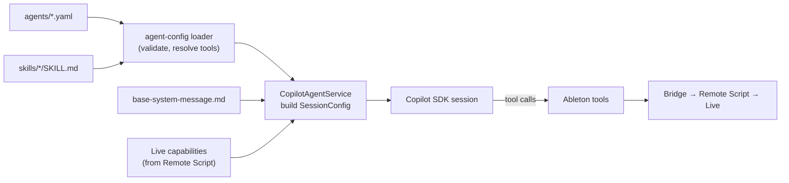
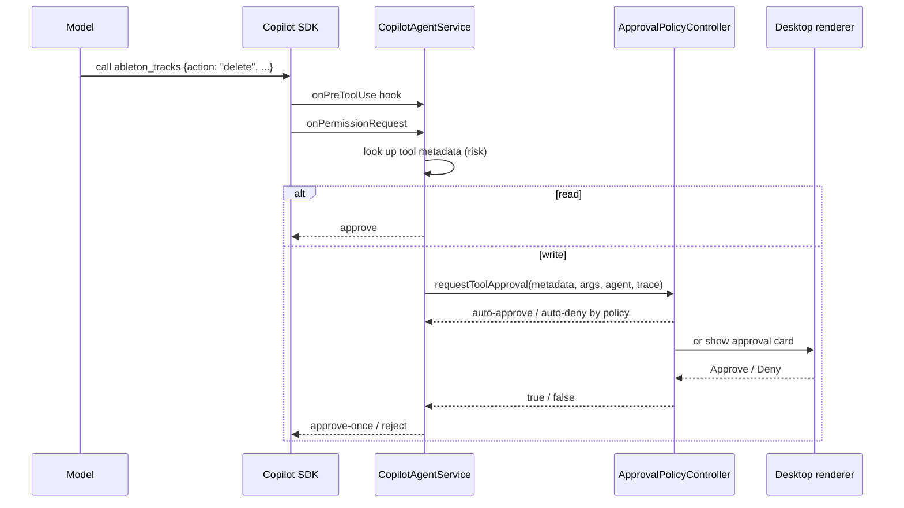

# The agent runtime

The "agent" is a GitHub Copilot SDK session that talks to the user and calls
our Ableton tools. This page explains how that session is built: its system
prompt, the custom agent definition it runs as, the skills it can load, the
hooks we attach, and how a tool approval reaches the user. The agent never runs
code inside Ableton Live; it can only call the tools we register (see
[tools.md](tools.md)). Those tools reach Live through our **Remote Script**, a
Python script Live loads as a control surface. A **Live Set** is the open
Ableton project document.

## The pieces

| Piece                   | What it is                                                                  | Where                                                    |
| ----------------------- | --------------------------------------------------------------------------- | -------------------------------------------------------- |
| `CopilotAgentService`   | Owns every SDK session, builds its config, runs turns, records events.      | `packages/application/src/index.ts`                      |
| Agent policy (hooks)    | SDK hooks that inject context and block bad tool calls.                     | `packages/application/src/agent-policy.ts`               |
| Base system message     | Shared instructions every agent gets.                                       | `packages/application/prompts/base-system-message.md`    |
| Custom agent definition | A YAML file: prompt, tools, edit scope, skills, defaults.                   | `agents/*.yaml`, schema in `packages/agent-config`       |
| Agent Skill             | A Markdown file of reusable know-how the agent loads on demand.             | `skills/*/SKILL.md`                                      |
| Runtime composition     | Wires the bridge to Live, listening, Live Events and the agent service.     | `packages/runtime/src/composition.ts`                    |
| Approval policy         | Decides whether to ask the user, auto-approve or deny.                      | `apps/desktop/src/main/approvals.ts`                     |

`createAgentRuntime` in `packages/runtime/src/composition.ts` builds the
Ableton bridge service, the prepared project context store, the Live Event and
save runtimes, and finally a `CopilotAgentService`. The Desktop app and the CLI
both use it.

## How a session is created

Each **active agent** (one running conversation) has exactly one SDK session.
When the user activates an agent, `CopilotAgentService` builds a
`SessionConfig` (search for `clientName: "ableton-agent-app"` in
`packages/application/src/index.ts`):

- **Model and reasoning** come from the agent definition, plus the global
  reasoning-summary preference.
- **Streaming** is always on.
- **Tools**: the Ableton tools the definition allows, filtered by what the
  connected Live set supports, plus a few application tools (`skill`,
  `read_plan`, `write_plan`) and a small, approved set of SDK built-ins (for
  example `ask_user`). `availableTools` is an exact allowlist and SDK tool
  search is off, so the model sees every allowed tool up front and nothing else.
- **Custom agents**: the active definition is passed as a `customAgents`
  entry and selected with `agent`, with `infer: false` so the SDK never
  switches to it on its own. Delegatable definitions are added as further
  entries the active agent can start as sub-agents (see
  [Sub-agents](#sub-agents)).
- **System message**: the base system message, an identity block (the current
  Live Set ID, Project ID and app-session ID), the list of enabled skills, and
  a **Memory** section built from every scope's `memory/INDEX.md` (see
  [Memory and skill authoring](#memory-and-skill-authoring)).
- **Hooks and callbacks**: the agent policy hooks, the permission handler,
  elicitation (`ask_user`) and plan-approval handlers.
- **Large output**: big tool results spill to a file in the profile's storage.
  The agent may read them only through a locked-down `bash` (see below).

The SDK owns conversation persistence. To restore a conversation the app
resumes the SDK session by ID.



### Plan mode

A turn runs in either **interactive** or **plan** mode. In plan mode the agent
may inspect Live but every Ableton mutation is rejected. It writes a plan to
one canonical `plan.md` per app session (via `read_plan` / `write_plan`),
asks questions with `ask_user`, and finishes with `exit_plan_mode`. The app
then shows the plan for the user to approve. Plan turns get an extra prompt
suffix from `packages/application/prompts/plan-reminder.md`.

### Turn timeout

Each turn has an active-work budget (10 minutes by default, set in Desktop
preferences). The clock pauses while the app is waiting for the user to answer
a question, approve a tool, or review a plan.

## System prompt and behavior

The shared prompt is short. It tells every agent to:

- use only the provided tools and inspect Live before making claims or edits;
- separate what it observed from what it suggests;
- search the Ableton Browser for a sound before creating a track for it;
- do dependent edits one at a time, and never retry an edit that may already
  have applied (re-inspect instead);
- explain musical patterns with ASCII art.

The custom agent's own `systemPrompt` is layered on top. Small extra guidance
is appended only when the agent has the related tool (Set History search,
`bash`, listening).

## Custom agents

A **custom agent definition** is a YAML file describing a specialist. The
bundled ones live in `agents/`: `default`, `compose`, `arrange`, `sound` and
`mix`.

```yaml
version: 1
name: compose
description: Creates and revises musical material, clips, notes, and parts.
systemPrompt: |
  Focus on composition: rhythm, melody, harmony, motifs, MIDI clips, notes...
tools:
  - "*"
editScope:
  - session
skills:
  - midi-composition
inputChannels: []
```

Version 2 adds a `label`, `model`, `reasoningEffort`, `autoApprove`,
`delegatable` and Live Event listeners (see [live-events.md](live-events.md)). The schema is in
`packages/agent-config/src/schemas.ts`.

Key fields:

- **`tools`** — tool names or operation IDs, with `*` wildcards
  (`ableton_devices`, `tracks.delete`, `recording.set_*`). Patterns are
  resolved against the real tool catalog by
  `packages/agent-config/src/tool-patterns.ts`. A pattern that matches
  nothing makes the definition invalid. `*` does not grant SDK orchestration
  tools such as `task` or `write_agent`; those must be named exactly.
- **`editScope`** — `session` lets the agent edit anything it has tools for.
  A track selector (`track: { name: Drums }`) limits edits to that track. The
  selector is bound to a stable track reference when the agent starts. Reads
  are never limited by edit scope.
- **`skills`** — which skills the model may load on its own.

Definitions are layered. The loader
(`loadLayeredAgentCatalog` in `packages/agent-config/src/loader.ts`) reads
bundled, system, profile, project and session layers; a later layer overrides
an earlier one by name. Saving an agent from the Desktop **Agents** tab writes
a copy into the current session's layer, so bundled files are never changed.

### Sub-agents

An agent can hand a self-contained piece of work to another agent through the
SDK's `task` tool, and follow up with `read_agent`, `write_agent` and
`list_agents`. The parent needs those tools named in its `tools` (the bundled
`default` agent has them). Every definition with `delegatable: true` (for
example `compose`) is offered to every parent as a `task` agent type; the SDK
client runs in empty mode, so there are no SDK built-in agents.

Sub-agents run inside the parent's SDK session:

- **Tools** are the delegate's resolved tools intersected with the parent
  session's tools, minus the parent-only tools (orchestration, `ask_user`,
  `exit_plan_mode`, `write_plan`). The parent's handlers, edit scope, plan mode
  and approvals therefore apply unchanged. `skill` only serves the sub-agent
  its own skills.
- **Prompt** is the delegate's `systemPrompt`, its tool guidance and a short
  sub-agent note. The `onSubagentStart` hook adds the same identity and project
  context as the parent gets.
- **Approvals** are attributed: the card says which sub-agent asked.
- **Background** sub-agents (`mode: "background"`) keep the turn open until
  they finish; aborting the turn stops them too.
- **Visibility**: sub-agent text never reaches the parent's chat. Its start,
  intent and finish appear nested in the parent's Working timeline, and
  `agent.subagent.started|completed|failed` events record it in History.

An **active agent** is a running instance of a definition. It keeps a snapshot
of its definition, so later edits to the YAML only take effect after the user
resets that agent.

## Agent Skills

A **skill** is a folder with a `SKILL.md`: YAML front matter (`name`,
`description`, and an optional `argument-hint`) followed by Markdown
instructions. Typing `/` in the composer lists skills, and an
`argument-hint` is shown there as the usage line (`/{name} {argument-hint}`).
Bundled skills are in
`skills/` (for example `midi-composition`, `mix-review`,
`set-history-sql-search`).

Skills are loaded progressively so they don't bloat every prompt:

1. Only the `name` and `description` of each enabled skill go into the system
   message.
2. When a skill looks relevant, the model calls the application's
   `skill(skill_name=...)` tool, which returns the body. It refuses skills not
   enabled for that agent.
3. The user can also type `/skill-name` (optionally followed by a request) in
   the composer. This works for any valid skill, enabled or not.

The SDK's own skill tool is deliberately excluded. Skills add knowledge; they
never grant extra tools or edit rights. Parsing for `/skill` commands is in
`packages/agent-config/src/skill-invocation.ts`.

## Memory and skill authoring

Memory and skills are plain folders of text files at each scope (System,
Profile, Project, Live Set and Session; skills skip Live Set). A memory folder
is a small wiki: one `{topic}.md` per topic, with a `description` in its front
matter, plus an `INDEX.md` the app generates from those descriptions. Each
scope holds at most 19 topics of at most 16 KiB.

Every scope's `INDEX.md` goes into the system message, broadest first and
capped at 12 KiB. Topic bodies are not preloaded; the agent reads them when
it needs them.

Two bundled skills let the agent write memory and skills:

```text
/update-memory
/update-memory remember that I prefer -14 LUFS masters --scope profile
/learn-skill turn the sidechain setup we just did into a skill --scope project
```

- With no request, `update-memory` looks back over the session and drafts
  what seems worth keeping; `learn-skill` turns a repeatable procedure from
  the session into a skill.
- `--scope system|profile|project|live-set|session` is optional and can go
  anywhere in the request. Memory defaults to Session and skills to Profile.
- The model can also load either skill itself with the `skill` tool.

### The workspace

Loading either skill opens one in-memory **draft**
(`packages/application/src/artifact-authoring.ts`). The agent edits a
per-session scratch folder, the **artifact workspace**
(`artifact-workspace.ts`), with the SDK's own file tools. The folder holds
copies of `memory/{scope}/…` and `skills/{name}/SKILL.md`. The app reseeds it
when a draft opens, when a draft closes without publishing, and whenever it
reloads the memory index for a turn, so unsaved edits never look saved.

Every SDK file call asks the permission handler first, and
`evaluateArtifactWorkspacePermission` decides:

| Access                          | Allowed when                                                                                                          |
| ------------------------------- | --------------------------------------------------------------------------------------------------------------------- |
| Read (`view`, `glob`, `grep`)   | The path is inside the workspace or the tool-output spill folder.                                                     |
| Write (`create`, `edit`)        | A draft of the matching kind is open, no review is pending, the path is a valid artifact path (not `INDEX.md`), and the scope is writable. |
| `bash` `rm`                     | A single, flag-free `rm` of a writable draft memory topic. Emptying a topic file also deletes it.                     |
| `bash` `mkdir`                  | A single `mkdir [-p]` of a new `skills/{name}` folder during a skill draft; `create` refuses a missing parent folder. |

Everything else, including symbolic links, is refused with a hint the model
can act on. File tool refusals use the code `artifact_workspace_blocked`;
`bash` refusals use `shell_policy_blocked`. Skills cannot
be deleted.

When `bash` runs in the OS sandbox, the two `bash` rows don't apply. The
sandbox lets bash write to its scratch folder and to this session's artifact
workspace, and nowhere else. Writes there are still published only through
review: when a draft is submitted, the app compares the workspace with its
starting copy.

### Review

The agent calls `submit_artifact_draft` when it is done. It first waits (up to
30 seconds) for any `create` or `edit` calls still running alongside it, so a
parallel write is not missed. If submit fails, the agent gets the reason
as text. The app then collects the
workspace changes, checks them, and blocks the tool call until the user
decides in the Inspector (see [Desktop app](desktop-app.md#memory-and-skill-review)):

| Decision          | What the agent gets back                                   |
| ----------------- | ---------------------------------------------------------- |
| `approve`         | The published paths, or the publish error.                 |
| `request_changes` | The user's feedback; the draft stays open for a revision.  |
| `discard`         | The draft closes; nothing is written.                      |

Publishing writes through the scoped artifact services and is checked against
a fingerprint taken when the draft was read. If the files changed in the
meantime, publishing fails and the agent is told to reload the skill. Skill
publication refreshes the agent catalog. A narrower skill with the same name
blocks publication, and two files cannot target the same topic in one scope.
Non-interactive CLI runs reject reviews, just like plan approvals.

Lifecycle events (`agent.artifact_draft.*`, `agent.artifact_review.*`,
`agent.artifact_publish.*`, `agent.artifact_workspace.*`) carry trace and
correlation IDs but never file bodies.

## Hooks

The SDK lets us attach hooks to a session. Ours are created by
`createAgentPolicy` in `packages/application/src/agent-policy.ts`:

| Hook                    | What it does                                                                                                                                                 |
| ----------------------- | ------------------------------------------------------------------------------------------------------------------------------------------------------------ |
| `onSessionStart`        | Adds a short note about project context (or the context itself).                                                                                            |
| `onUserPromptSubmitted` | Adds prepared project context, a changed-identity block if the Live Set changed, pending Live Event / signal context, and Browser search hints.            |
| `onPreToolUse`          | Denies Ableton mutations during plan mode and automatic-analysis turns. Denies an exact repeat of a call that was already denied or failed non-retryably.  |
| `onPostToolUse`         | Reminds the model to treat the verified result as the current state, plus a few tool-specific notes.                                                         |
| `onPostToolUseFailure`  | Tells the model whether to retry, and records the failed call so an identical retry is blocked.                                                              |

Hooks are guidance and a first filter. The real enforcement (allowlist, edit
scope, approval, locks) happens in the permission handler and the tool
wrapper. See [safety.md](safety.md).

## How a tool approval reaches the user



1. The SDK calls our `onPermissionRequest`. It looks up the tool's metadata
   from the call's arguments (`createAbletonPermissionHandler` in
   `packages/tools/src/index.ts`).
2. Reads are approved straight away. Everything else calls
   `requestToolApproval`.
3. In Desktop this goes to `ApprovalPolicyController`
   (`apps/desktop/src/main/approvals.ts`), which applies the user's approval
   policy and any per-agent auto-approve ("YOLO") setting, or forwards it to
   `ApprovalCoordinator`. That publishes an approval card to the renderer
   showing the title, risk, and arguments.
4. The user clicks **Approve** or **Deny**. A denial is reported to the model
   as a user denial, and the same call is then blocked from being retried.

While the request waits, the turn timeout is paused. If no window can show the
card, or the app shuts down, the request is denied rather than left hanging.
The `/yolo` command (`apps/desktop/src/renderer/yolo-command.ts`) turns
auto-approve on or off for the selected agent, or with `all` for every agent in
the session.

## Multiple agents at once

Several agents can be active in the same app session, even several from the
same definition. Each one has its own SDK session, conversation, plan mode,
tool list and edit scope.

- Every event, approval, and cancellation carries the agent instance ID, so
  one agent's YOLO setting can never approve another agent's request.
- Reads run in parallel.
- Mutations take a lock first (`AbletonMutationLockManager` in
  `packages/tools/src/mutation-policy.ts`). A session-wide mutation locks the
  whole set; a track mutation locks only its tracks. Edits to different tracks
  can run at the same time; overlapping edits wait in line.
- After the lock is acquired, scope and track identity are checked again, so an
  agent never edits with stale permission.

## Where to look in the code

| Topic                                 | File                                                     |
| ------------------------------------- | -------------------------------------------------------- |
| Session config, turns, plan mode      | `packages/application/src/index.ts`                      |
| Hooks and retry guidance              | `packages/application/src/agent-policy.ts`               |
| Restricted `bash` policy              | `packages/application/src/shell-policy.ts`               |
| Plan file storage                     | `packages/application/src/plan-artifact.ts`              |
| Prompts                               | `packages/application/prompts/`                          |
| Agent/skill schemas, loader, patterns | `packages/agent-config/src/`                             |
| Memory library, authoring, workspace  | `packages/agent-config/src/memory.ts`, `packages/application/src/artifact-*.ts` |
| Runtime wiring                        | `packages/runtime/src/composition.ts`                    |
| Per-turn project context              | `packages/runtime/src/prepared-context.ts`               |
| Approval policy and UI bridge         | `apps/desktop/src/main/approvals.ts`                     |
