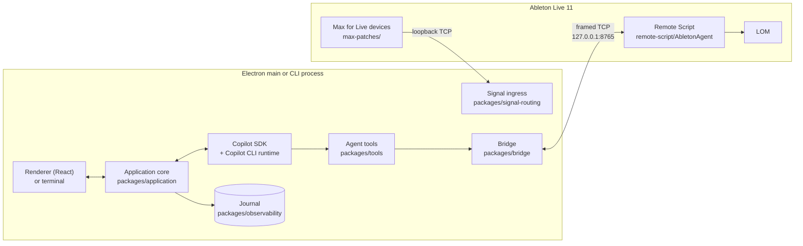
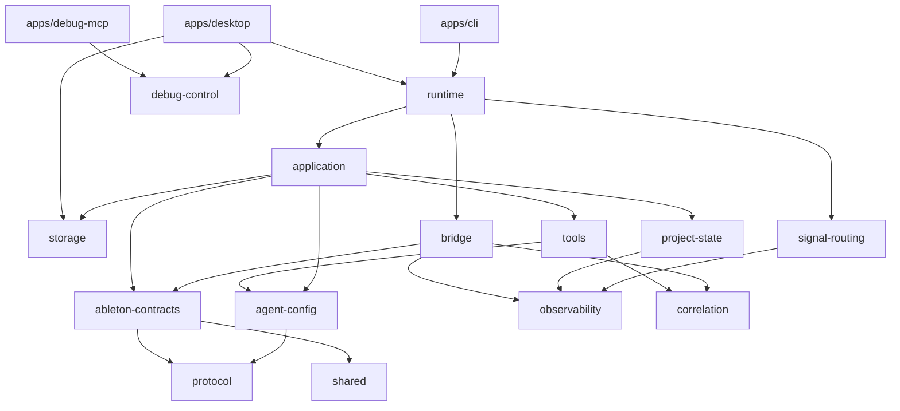

# Architecture

Ableton Agent is a TypeScript monorepo plus a small Python package that runs
inside Ableton Live 11. The TypeScript side hosts a GitHub Copilot SDK agent
and the tools it can call. The Python side is the only code that touches Live
itself. This page is a map: which folder does what, which processes run, and
how one user prompt travels to Live and back.

## Key terms

| Term | Meaning |
| --- | --- |
| **Live Set** | One Ableton document (`.als` file). |
| **LOM** | Live Object Model: Live's internal Python API for tracks, clips, devices, and transport. |
| **Remote Script** | A Python package Live loads at startup as a "control surface". Ours lives in `remote-script/AbletonAgent/`. |
| **Max for Live** | Max patches packaged as Live devices (`.amxd`). Ours capture MIDI and analyse audio. |
| **Session / Arrangement** | Live's two views: clip-launching grid vs. linear timeline. |
| **Copilot SDK** | `@github/copilot-sdk`. It runs the model/tool loop; we supply tools, policy, and UI. |

## Repository map

### Apps (`apps/`)

| Folder | Purpose |
| --- | --- |
| `apps/desktop` | Electron app. `src/main` owns all privileged services, `src/preload` exposes a typed IPC API, `src/renderer` is the React UI. |
| `apps/cli` | Terminal client (`ableton-agent chat` / `run`). Same runtime as Desktop, terminal presentation. |
| `apps/debug-mcp` | Stdio MCP server that drives a Desktop instance launched in automation mode, for end-to-end UX testing. |

### Packages (`packages/`)

| Folder | Purpose |
| --- | --- |
| `packages/protocol` | Zod schemas for every app ↔ Remote Script command, event, and frame. Source of truth for the wire format. |
| `packages/shared` | Small shared types and helpers: errors, connection status, version compatibility, Max device metadata. |
| `packages/ableton-contracts` | The `AbletonService` interface that tools and the application program against. |
| `packages/bridge` | TCP client that implements `AbletonService`: handshake, request queue, timeouts, reconnect, Live events. |
| `packages/tools` | The `ableton_*` agent tools (session, tracks, clips, devices, listening, history search, …) and mutation policy. |
| `packages/agent-config` | Loads and validates agent YAML definitions and skills; tool allowlist patterns. |
| `packages/application` | Headless application core: `HeadlessApplication`, `CopilotAgentService`, approvals policy, project context, listening coordination. |
| `packages/runtime` | Composition root. `createAgentRuntime` wires bridge, agent service, tools, and telemetry together. |
| `packages/project-state` | SQLite-backed project snapshot and per-session entity-context (listening) stores. |
| `packages/signal-routing` | Loopback TCP ingress and router for signals from Max for Live devices (MIDI capture, audio listener metrics). |
| `packages/observability` | Event envelope schemas, sanitizer, non-blocking recorder, and the SQLite journal. See [Observability](observability.md). |
| `packages/correlation` | `AsyncLocalStorage` carrier for trace/correlation IDs across async calls. |
| `packages/storage` | Resolves every path under `~/.live-agent`. See [Storage](storage.md). |
| `packages/debug-control` | Authenticated loopback client/server used by `apps/debug-mcp` to control Desktop. |
| `packages/workflows` | Deterministic multi-step workflow executor with mutation leases. Not yet consumed by any app or package. |
| `packages/test-support` | Fake Ableton and agent services so the full runtime boots without Live or Copilot. |

### Other top-level folders

| Folder | Purpose |
| --- | --- |
| `remote-script/` | `AbletonAgent/` Python Remote Script, a `simulator.py`, and Python unit tests in `tests/`. |
| `max-patches/` | Max for Live sources: `midi-capture/`, `audio-listener/`, and `shared/` JavaScript used by both. |
| `agents/` | Bundled agent definitions (`default.yaml`, `compose.yaml`, `mix.yaml`, …): prompt, tools, edit scope, skills. |
| `skills/` | Bundled agent skills, one folder per skill with a `SKILL.md`. |
| `integration/` | Real-Live test data: `live-scenarios/`, `acceptance-scenarios/`, and Live Set `fixtures/`. |
| `scripts/` | Node scripts behind `pnpm` commands: acceptance runner, Live validation, device builds, installers, repo checks. |
| `tests/electron/` | Playwright tests for the Electron app. |

## Runtime processes

- The **renderer** is presentation only. It talks to Electron main through the
  typed preload API (`apps/desktop/src/preload`) and never sees credentials,
  the SDK, or the socket.
- **Electron main** (or the **CLI**) hosts everything else in one Node
  process. Both start from `createAgentRuntime` in
  `packages/runtime/src/composition.ts`.
- The **Copilot SDK** starts the Copilot CLI runtime and talks to it over
  JSON-RPC. The runtime chooses tools; our code runs them.
- The **Remote Script** listens on loopback port 8765, authenticates the bridge
  with a shared token, and runs every LOM call on Live's main thread
  (`remote-script/AbletonAgent/executor.py`).
- **Max for Live devices** push MIDI and audio-analysis data to the app's
  signal ingress. They do not go through the Remote Script.

## Package dependencies

Arrows point from a package to what it imports (main edges only; see each
`package.json` for the full list). Everything flows inward toward the protocol
and shared contracts. Nothing in `packages/` imports an app.

A few things worth noticing:

- `application` and `tools` depend on the `AbletonService` interface in
  `ableton-contracts`, not on `bridge`. Only `runtime` picks the real bridge
  (or a stand-in that reports `configuration_missing` when no token is set).
- `protocol`, `shared`, `observability`, `correlation`, `storage`, and
  `debug-control` have no internal dependencies.
- Desktop adds Electron-only pieces (IPC, approvals UI, profile manager,
  logger) on top of the runtime. The CLI adds terminal I/O and prompts.

## Main request flow

1. **Prompt.** The user sends a message in Desktop or the CLI. Desktop routes
   it over IPC to `DesktopService` in Electron main.
2. **Context.** `HeadlessApplication` (`packages/application`) attaches a
   compact snapshot of the open Live Set and any prepared context, then sends
   the turn to the Copilot SDK session.
3. **Tool choice.** The model picks a tool such as `ableton_tracks` and an
   action with arguments.
4. **Approval.** The SDK asks permission. The application applies agent policy
   and edit scope; mutating calls may prompt the user (Desktop approval card or
   CLI prompt).
5. **Tool handler.** The handler in `packages/tools` runs inside a correlation
   context keyed by the tool call ID, validates the arguments with the
   action's Zod schema, checks the connection, and calls `AbletonService`.
6. **Bridge.** `packages/bridge` queues the request in a single FIFO, then
   sends a length-prefixed JSON frame with a request ID when it is dispatched.
7. **Live.** The Remote Script schedules the command on Live's main thread, a
   handler reads or changes the LOM, and a structured response comes back.
8. **Result.** The tool returns a concise result to the model and structured
   data to the UI. The model continues or answers; every stage is recorded in
   the journal.

## Where to look in the code

| Question | Start here |
| --- | --- |
| How is everything wired? | `packages/runtime/src/composition.ts` |
| How does Desktop start? | `apps/desktop/src/main/main.ts`, `apps/desktop/src/main/composition.ts` |
| What does the agent turn loop look like? | `packages/application/src/index.ts` (`CopilotAgentService`, `HeadlessApplication`) |
| What tools exist? | `packages/tools/src/index.ts` |
| What goes over the socket? | `packages/protocol/src/framing.ts`, `packages/protocol/src/catalog.ts` |
| How does Live run commands? | `remote-script/AbletonAgent/server.py`, `remote-script/AbletonAgent/executor.py` |

Related pages: [Overview](overview.md), [Agent](agent.md), [Tools](tools.md),
[Live connection](live-connection.md), [Desktop app](desktop-app.md),
[CLI](cli.md).
