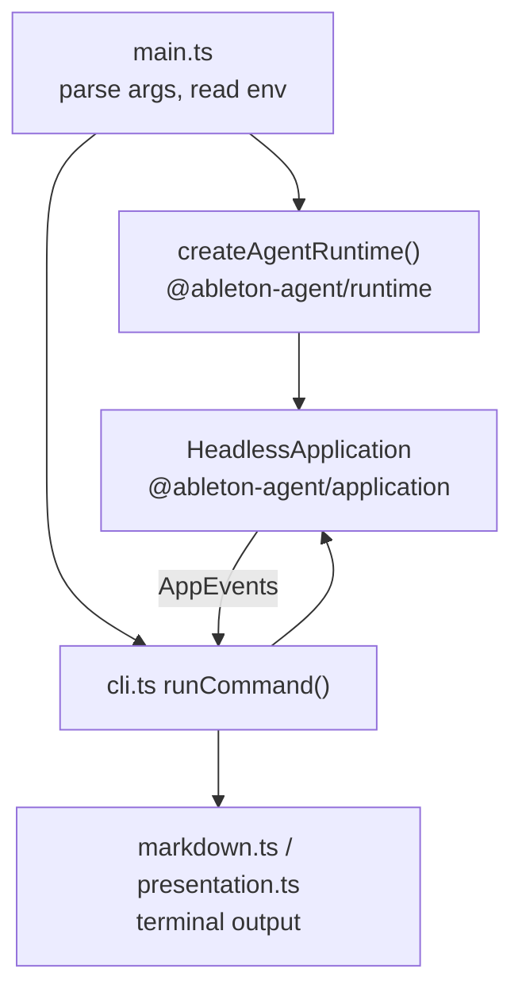

# CLI

The CLI (`apps/cli`) is a terminal client for Ableton Agent. It uses the same
agent core, tools, and Ableton bridge as the [desktop app](desktop-app.md),
with no Electron. It is the quickest way to check the connection to Live, look
at a Set, run a one-off prompt from a script, and drive real-Live smoke tests.

## Setup

Build once with `pnpm run bootstrap` (or `pnpm build`). The binary is
`ableton-agent`, built to `apps/cli/dist/main.js`:

```bash
node apps/cli/dist/main.js status
pnpm cli status          # same thing, run from source via tsx
```

The CLI reads its settings from environment variables
(`packages/runtime/src/composition.ts`):

| Variable              | Meaning                                                                                                 |
| --------------------- | ------------------------------------------------------------------------------------------------------- |
| `ABLETON_AGENT_TOKEN` | Bridge token. Required to reach Live. Copy it from the installed `AbletonAgent/.ableton-agent-token`.   |
| `ABLETON_AGENT_PORT`  | Bridge port. Defaults to `8765`, which is also the Remote Script default.                               |
| `ABLETON_AGENT_MODEL` | Optional Copilot model override.                                                                        |

Unlike the desktop app, the CLI does not discover the token file for you:

```bash
export ABLETON_AGENT_TOKEN="$(
  cat "$HOME/Music/Ableton/User Library/Remote Scripts/AbletonAgent/.ableton-agent-token"
)"
```

See [live-connection.md](live-connection.md) for how the bridge and Remote
Script fit together, and [packaging.md](packaging.md) for installing the
Remote Script.

## Modes

Running `ableton-agent` with no arguments prints help. The commands fall into
three groups.

### Interactive chat

```bash
ableton-agent chat
```

Opens a prompt loop with the agent. Plain text goes to the Copilot session.
Lines starting with `/` are handled locally.

### One-shot prompt

```bash
ableton-agent run "summarize the current arrangement" --json
```

Sends one prompt, waits for the agent to finish, prints the result, and exits
with a meaningful code. Options:

| Option            | Meaning                                                                                                       |
| ----------------- | ------------------------------------------------------------------------------------------------------------- |
| `--session ID`    | Resume this Copilot session instead of starting a new one.                                                    |
| `--timeout-ms N`  | Turn deadline, 10000–600000 ms.                                                                               |
| `--trace PATH`    | Write a bounded, redacted JSON trace of the turn as it runs, so a stuck or killed run still leaves evidence.  |
| `--scenario ID`   | Run a reviewed test scenario. Only accepted with that scenario's exact prompt. See [testing.md](testing.md).  |

### Direct commands (no model)

These call application services directly and do not talk to the model:

| Command                                                         | What it shows                                                          |
| --------------------------------------------------------------- | ---------------------------------------------------------------------- |
| `status`                                                        | Bridge connection state.                                               |
| `doctor`                                                        | Pings the Remote Script.                                               |
| `live-smoke`                                                    | Connection, versions, and a few read-only inspections in one go.       |
| `capabilities`                                                  | What the connected Remote Script supports.                             |
| `snapshot`                                                      | Summary of the current Live Set.                                       |
| `transport`                                                     | Arrangement loop and cue points.                                       |
| `devices <track>`                                               | Devices on a track.                                                    |
| `parameters <track> <device>`                                   | A device's parameters.                                                 |
| `rack-chains`, `chain-devices`, `drum-pads`, `pad-chains`, ...  | Walk inside racks and Drum Racks. Paged with `--offset` / `--limit`.   |
| `browser-roots`, `browser-category`, `browser-search`           | Explore Live's browser.                                                |
| `browser-load <track> "<query>" <result> --approve`             | Load a browser result onto a track. The one direct command that edits. |
| `session-current`, `session-new`, `session-resume <id>`         | Manage the Copilot session.                                            |

Track, device, chain, and pad numbers are one-based. `ableton-agent help`
prints the full syntax.

## Interactive commands

Inside `chat`:

| Command                | Effect                                     |
| ---------------------- | ------------------------------------------ |
| `/help`                | List commands.                             |
| `/status`              | Connection status.                         |
| `/doctor`              | Ping the Remote Script.                    |
| `/snapshot`            | Inspect the current Live Set.              |
| `/transport`           | Arrangement loop and cue points.           |
| `/session`             | Show the current Copilot session ID.       |
| `/session new`         | Start a fresh Copilot session.             |
| `/session resume <id>` | Switch to an existing session.             |
| `/exit`                | Leave chat.                                |

While the agent works, tool activity streams as short lines:
`• Inspecting arrangement...`, `✓ Inspected 6 tracks`, `✗ Device load failed`.

## Approvals

Read-only tools run without asking (except under `--scenario`). What happens
with changes depends on the mode (`packages/tools/src/index.ts`, `createAbletonPermissionHandler`):

| Mode                | Changes to the Live Set                                                                                                     |
| ------------------- | --------------------------------------------------------------------------------------------------------------------------- |
| `chat`              | Each change asks `Approve once? [y/N/d for details]`. `d` prints title, risk, capability, and arguments. Anything else denies. |
| `run`               | Every change is denied. If the agent asks a question or wants plan approval, the run fails with `approval_required`.        |
| `run --scenario`    | Every tool call, reads included, is checked against the scenario's reviewed allowlist and approved only if it matches.      |

There is no blanket `--yes` flag. See [safety.md](safety.md) for the safety
checks that run no matter how a change is approved.

## Output formats

| Flag             | Effect                                                              |
| ---------------- | ------------------------------------------------------------------- |
| _(none)_         | Human-readable output.                                              |
| `--json`         | Structured JSON for scripts (not accepted by `chat`).               |
| `--quiet`, `-q`  | Only the final result; progress lines are hidden.                   |

Assistant Markdown is rendered for the terminal (`apps/cli/src/markdown.ts`):
styled headings, lists, code blocks, and tables that fall back to labeled
records in narrow windows. Rich formatting is used only on a real TTY.
Redirected output is plain text with no ANSI codes, and `NO_COLOR` turns off
color but keeps the layout (`apps/cli/src/terminal.ts`). Any terminal control
codes coming from the model are stripped.

## Exit codes

Defined in `apps/cli/src/exit-codes.ts`. Scripts and CI depend on these
numbers, so do not renumber them.

| Code  | Meaning                                                                                    |
| ----- | ------------------------------------------------------------------------------------------ |
| `0`   | Success.                                                                                   |
| `2`   | Invalid input: bad arguments or bad configuration (e.g. an invalid `ABLETON_AGENT_PORT`).  |
| `3`   | Ableton connection or compatibility failure (not connected, auth failed, timeout, protocol mismatch). |
| `4`   | Approval denied, or approval needed but no human was available (`run`).                    |
| `5`   | An agent or tool operation failed for another reason.                                      |
| `130` | Interrupted with Ctrl+C.                                                                   |

If a `run` turn has several failed operations, any connection failure wins
(`3`). If every failure is an approval failure, the code is `4`. Otherwise it
is `5`.

## How it fits together



The CLI and desktop share `@ableton-agent/runtime` and
`@ableton-agent/application`. The desktop does not depend on the CLI, and the
CLI never imports Electron code.

## Where to look in the code

| Topic                              | Path                                |
| ---------------------------------- | ----------------------------------- |
| Entry point, env, approval wiring  | `apps/cli/src/main.ts`              |
| Argument parsing and commands      | `apps/cli/src/cli.ts`               |
| Exit codes                         | `apps/cli/src/exit-codes.ts`        |
| TTY and color detection            | `apps/cli/src/terminal.ts`          |
| Markdown rendering                 | `apps/cli/src/markdown.ts`          |
| Snapshot/device text formatting    | `apps/cli/src/presentation.ts`      |
| `--trace` writer                   | `apps/cli/src/run-trace.ts`         |
| Reviewed scenarios (`--scenario`)  | `apps/cli/src/scenario.ts`          |
| Shared runtime composition         | `packages/runtime/src/composition.ts` |
