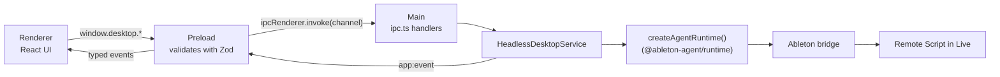

# Desktop app

The desktop app (`apps/desktop`) is the main way people use Ableton Agent. It is
an Electron app with a React UI: you chat with agents, watch their tool
activity, approve changes to your Live Set, and inspect history. It runs the
same agent core as the [CLI](cli.md); it just adds a visual layer on top.

## Three processes, one trust boundary

Electron splits an app into separate processes. We use that split as a
security boundary (see [ADR 0001](decisions/0001-electron-security-boundary.md)).

| Process      | Code                            | What it does                                                                                                                |
| ------------ | ------------------------------- | --------------------------------------------------------------------------------------------------------------------------- |
| **Main**     | `apps/desktop/src/main/`        | Trusted Node.js process. Owns Copilot, the Ableton bridge, storage, credentials, installers, logging.                       |
| **Preload**  | `apps/desktop/src/preload/`     | Tiny script that exposes one typed object, `window.desktop`, to the page.                                                   |
| **Renderer** | `apps/desktop/src/renderer/`    | The React UI. Untrusted: no Node, no filesystem, no sockets, no credentials.                                                |

The window is created in `main/window-options.ts` with `contextIsolation`,
`sandbox` and `webSecurity` on and `nodeIntegration` off. `main/main.ts` also
blocks in-app navigation and only opens `https://` links in the system browser.
The renderer page has a Content Security Policy in `renderer/index.html`.

The practical rule: if the UI needs a new capability, you add a new typed IPC
channel. There is no generic "invoke anything" escape hatch.



## How the UI talks to the core (IPC)

IPC (inter-process communication) is how the renderer asks main to do things.

- **Contracts.** `apps/desktop/src/contracts.ts` defines `ipcSchemas`: one Zod
  request schema and one response schema per channel, such as `agents:send`,
  `approvals:resolve`, `ableton:snapshot` or `event-history:search`. It also
  defines `appEventSchema` for pushed events.
- **Preload.** `preload/api.ts` builds the `DesktopApi` object. It parses every
  request before sending and every response after receiving. Read queries also
  get a fresh trace/correlation/causation ID tuple so the work can be followed
  in History.
- **Main.** `main/ipc.ts` registers one handler per channel. Each handler
  rejects senders that are not our own window, parses the request again, calls
  the service, and parses the response before returning it.
- **Events.** Main pushes application events (assistant text, operation
  progress, approvals, connection changes, and so on) on a single `app:event`
  channel. The renderer folds them into display state in `renderer/state.ts`.
  The UI derives state from these typed events, never from assistant prose.

Behind the handlers, `main/composition.ts` builds the app: it calls
`createAgentRuntime()` from `@ableton-agent/runtime` (the same composition the
CLI uses) and wraps it in `HeadlessDesktopService`
(`main/headless-desktop-service.ts`). That service holds no Electron UI code,
so it can be tested without a window. See [architecture.md](architecture.md)
for the bigger picture and [agent.md](agent.md) for the agent runtime itself.

### Startup in short

1. Resolve the storage profile and load preferences. Data lives under
   `~/.live-agent/profiles/{profile}/` (see [storage.md](storage.md)).
2. Find the bridge token: `ABLETON_AGENT_TOKEN` if set, otherwise the
   `.ableton-agent-token` file in the installed Remote Script folder
   (`main/bridge-credentials.ts`). The token stays in memory only.
3. Compose the runtime, connect to Live, and pick the App session that belongs
   to the open Live Set (or start a fresh one).
4. Open the window.

Only one copy of the app runs at a time. An `ableton-agent://session/<id>` link
resumes a saved session (`main/lifecycle.ts`).

## Screens

The top bar holds the connection status and these tabs (list in
`renderer/App.tsx`). **Events**, **Browser**, and **Diagnostics** are advanced
views: they are hidden unless **Show advanced views** is on in Settings, but an
in-app link can still open one and its tab shows while it is open.

| Tab             | What you do there                                                                                                          |
| --------------- | -------------------------------------------------------------------------------------------------------------------------- |
| **Workspace**   | The main screen. Three columns: Project outline, Conversation, Inspector. The chat composer lives only here.               |
| **Agents**      | Browse agent definitions, start/rename/reset active agents, and edit their instructions, tools and listened-to events.    |
| **Skills**      | Read and edit `SKILL.md` skills. Saved skills show up as slash commands in the composer.                                   |
| **Outputs**     | Route MIDI/audio observations from Max for Live devices to agents; see listening passes and stored listening context.     |
| **Events**      | Define Live Events (watch a parameter, or a track's clip/recording changes). A **History** toggle opens the event journal. |
| **Browser**     | Look through Live's browser and installed plug-ins.                                                                        |
| **Profiles**    | Manage storage profiles and copy or move agents and skills between sessions.                                               |
| **Diagnostics** | Check the bridge, Remote Script compatibility, Copilot auth; copy a summary or export a support bundle.                    |
| **Sessions**    | List saved App sessions and resume one.                                                                                    |
| **Settings**    | Approval policy, work timeout, reasoning visibility, ports, Remote Script location, logging, history retention, "Always on top", "Show advanced views". |

A few Workspace details worth knowing:

- **Conversation.** Assistant replies are rendered Markdown. Each tool call is a
  compact row that you can expand to see the request, result, and any failure
  with a hint on how to fix it. Calls made by a sub-agent have a cyan accent
  and a chip with the sub-agent's name; the `task` call that launches a
  sub-agent has the same accent. A turn reads top to bottom: your message, its
  tool calls, then the reply. The in-progress reply stays last, and the
  conversation follows new activity while you are scrolled to the end; scroll
  up to stop following, and sending a message resumes it.
- **Composer.** Type a message or a slash command. While the slash menu is
  open, Tab or Enter completes the highlighted command; Enter on a fully typed
  command such as `/yolo` runs it. `/plan` (or Shift+Tab)
  switches the selected agent between plan and interactive mode. Selected
  tracks, clips and devices are attached as context chips.
- **Inspector.** Modular tabs for the current Selection, the session Plan,
  pending Approvals, and Context. You can reorder and split them. Context shows
  the selected conversation's latest Copilot-reported token usage and limit. A
  segmented bar with matching colored labels separates system messages, tool
  definitions, and conversation, in that order; used tokens without a reported breakdown
  are neutral. It counts completed and failed compactions observed since the
  app connected to that conversation, not historical ones.
- **Hiding panels.** Both sidebars and the top bar can be hidden, down to a
  small chat-only window (320×360).

[live-events.md](live-events.md), [listening.md](listening.md) and
[observability.md](observability.md) cover Events, Outputs and History in depth.

## Approvals

Read-only tools run without asking. Tools that change the Live Set ask first,
depending on the policy in Settings (`main/approvals.ts`):

| Policy                  | Behavior                                                    |
| ----------------------- | ----------------------------------------------------------- |
| Always ask              | Ask for every tool call, including reads.                   |
| Risky changes (default) | Reads run automatically; every change asks.                 |
| Approve all             | Approve everything without prompting.                       |
| Deny all changes        | Refuse every change.                                        |

When a change needs approval, the Inspector's **Approval** tab shows the
title, a risk level (low/medium/high, derived from the tool's metadata),
a summary, and the affected objects, with **Approve** and **Deny** buttons.
Destructive changes carry a warning. The decision goes back over the
`approvals:resolve` channel.

The composer also understands `/yolo` (same as `/yolo on`), `/yolo on|off`,
and `/yolo on|off all`.
It turns on automatic approval for the selected agent (or all active agents)
without changing the global policy. "Deny all" still wins.

Auto-approval only skips the human prompt. Schema validation, per-agent tool
and scope limits, target identity checks, and post-change verification all
still run. See [safety.md](safety.md).

The composer is also replaced in place by two other human-in-the-loop prompts:
questions the agent asks you (a form built from the agent's schema), and plan
approval (approve, request changes, or exit).

## Debug automation mode

Coding agents sometimes need to drive the real, visible app end to end. For
that, the app has an opt-in automation mode
([ADR 0005](decisions/0005-desktop-automation-mcp-adapter.md)).

```bash
pnpm desktop:dev -- \
  --automation \
  --automation-profile /absolute/path/to/fresh-profile \
  --automation-descriptor /absolute/path/automation-endpoint.json \
  --automation-agent default \
  --automation-yolo
```

| Flag                      | Meaning                                                                                                    |
| ------------------------- | ---------------------------------------------------------------------------------------------------------- |
| `--automation`            | Turn the mode on. All other flags are rejected without it.                                                 |
| `--automation-profile`    | Required absolute path. All app data for this run lives here, away from your normal profile.               |
| `--automation-descriptor` | Where to write the discovery file. Defaults to `automation-endpoint.json` inside the profile.              |
| `--automation-agent`      | Select (or create) an active agent from this definition at startup.                                        |
| `--automation-yolo`       | Turn on auto-approval for that agent. Requires `--automation-agent`.                                       |

In this mode, main starts a small authenticated server on `127.0.0.1` with a
random port (`main/automation-host.ts`, protocol in `packages/debug-control`).
It writes owner-only discovery and secret files and removes them on shutdown.

`apps/debug-mcp` is a separate stdio MCP server that reads the descriptor and
exposes exactly one tool, `send_user_message`. It sends a plain-text message to
the currently selected agent, which then appears in the UI like a normal user
turn. The tool returns as soon as the message is accepted. It does not wait for
the agent to finish, so you check results in the UI and in Live
(computer-use, screenshots). Normal launches never start this server.

The root `README.md` has a step-by-step quickstart, and the
`desktop-ux-testing` skill describes the full test loop. See also
[testing.md](testing.md).

## Running it

| Command              | What it does                                                                       |
| -------------------- | ---------------------------------------------------------------------------------- |
| `pnpm desktop:dev`   | Vite dev server + Electron. Renderer hot-reloads; restart for main/preload edits.  |
| `pnpm desktop:debug` | Same, with debug logging and DevTools opened.                                      |
| `pnpm desktop:dist`  | Build a packaged app. See [packaging.md](packaging.md).                            |

## Where to look in the code

| Topic                         | Path                                                     |
| ----------------------------- | -------------------------------------------------------- |
| Window security options       | `apps/desktop/src/main/window-options.ts`                |
| App entry and lifecycle       | `apps/desktop/src/main/main.ts`, `main/lifecycle.ts`     |
| IPC channels and schemas      | `apps/desktop/src/contracts.ts`                          |
| IPC handlers                  | `apps/desktop/src/main/ipc.ts`                           |
| `window.desktop` API          | `apps/desktop/src/preload/api.ts`                        |
| Service composition           | `apps/desktop/src/main/composition.ts`                   |
| Desktop service (no Electron) | `apps/desktop/src/main/headless-desktop-service.ts`      |
| Approval policy               | `apps/desktop/src/main/approvals.ts`                     |
| UI and reducer                | `apps/desktop/src/renderer/App.tsx`, `renderer/state.ts` |
| Automation mode               | `apps/desktop/src/main/launch-options.ts`, `main/automation-host.ts` |
| Debug MCP adapter             | `apps/debug-mcp/src/main.ts`                             |
