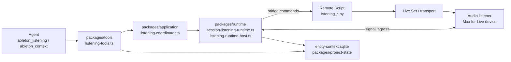
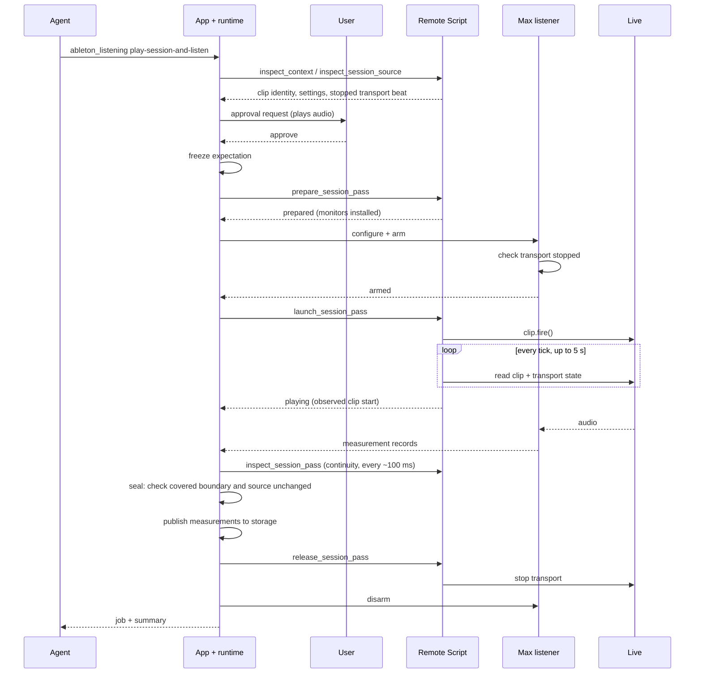

# Machine listening

The agent can play a Session clip or an Arrangement range and "hear" it: it gets
back audio measurements such as loudness, brightness, attacks, pitch and
spectral shape, laid out on a musical grid. This page explains why listening
needs a special device, which pieces are involved, how one listen runs from
start to finish, and how the agent reads the results later.

## Why listening needs a Max for Live device

The rest of the app talks to Ableton Live through the **Live Object Model
(LOM)**: Live's programmable view of tracks, clips, devices and transport. Our
**Remote Script** (Python running inside Live, see
[live-connection.md](live-connection.md)) uses the LOM to read and change the
Set. The LOM can tell you a clip's name, notes, gain or warp settings. It can't
give you the audio samples.

To hear audio we put a **Max for Live** device on the track. Max for Live lets
you build Live devices in Max, a visual programming environment for audio and
MIDI. A Max for Live device sits in a track's device chain like any other
effect, sees the real signal (after instruments and effects), and can run
JavaScript and DSP code.

| Device                     | Where                       | What it does                                                                                                     |
| -------------------------- | --------------------------- | ---------------------------------------------------------------------------------------------------------------- |
| Audio listener             | `max-patches/audio-listener` | Transparent audio effect. Captures samples and computes measurements. Controller: `audio_listener_metric_controller.js`. |
| MIDI capture               | `max-patches/midi-capture`  | Captures MIDI events on a track. Shares the same connection client.                                              |
| Shared producer client     | `max-patches/shared`        | `agent_signal_client.js` and `producer_identity.js`: find the app, authenticate, register, report track identity. |

Both devices are **producers**: they connect to the app's local signal ingress
(`SignalIngressServer` in `packages/signal-routing/src/ingress-server.ts`) over
loopback TCP, register, and stream measurements. The audio listener does its
analysis inside Max: native Gen/FFT code for level, attacks and spectrum, plus
bundled FluCoMa externals (`fluid.pitch~`, `fluid.spectralshape~`) and a mel-band
analyzer (`listener.mel~`) under `max-patches/audio-listener/dependencies/`.
Only processed measurements leave the device. Raw audio is never stored.

The listener is placed on a track by the user or a template; the app can't
insert Max devices through the Live 11 LOM.

## The pieces

| Layer            | Files                                                                                                                                                                                                           | Role                                                                                                     |
| ---------------- | --------------------------------------------------------------------------------------------------------------------------------------------------------------------------------------------------------------- | -------------------------------------------------------------------------------------------------------- |
| Agent tools      | `packages/tools/src/listening-tools.ts`, `listening-feature-views.ts`, `listening-summary.ts`                                                                                                                   | `ableton_listening` starts and inspects captures. `ableton_context` reads, compares and searches results. |
| Job coordinator  | `packages/application/src/listening-coordinator.ts`, `listening-host.ts`                                                                                                                                         | Runs one capture as a job through fixed stages, one at a time.                                           |
| Session runtime  | `packages/runtime/src/session-listening-runtime.ts`, `session-listening-driver.ts`, `session-listening-source.ts`                                                                                               | Checks the clip, drives the Remote Script pass, validates the result.                        |
| Arrangement runtime | `packages/runtime/src/listening-runtime-host.ts`                                                                                                                                                             | Same job stages for an Arrangement range. Also wires Session services in.                                |
| Capture plumbing | `packages/runtime/src/metric-listening-capture.ts`, `metric-listening-config.ts`, `metric-stream-publication.ts`                                                                                                | Arms listeners, collects measurement streams, publishes them to storage.                                 |
| Remote Script    | `remote-script/AbletonAgent/session_listening_source.py`, `session_listening_pass.py`, `listening_commands.py`, `listening_playback.py`, `arrangement_listening_source.py`                                    | Reads clip and transport state, launches the clip, monitors it, positions Arrangement playback.          |
| Storage          | `packages/project-state/src/context-repository.ts`, `metric-capture-repository.ts`                                                                                                                              | Stores captures and derived features per App session.                                                    |

### Remote Script commands

| Command                                                  | File                              | Purpose                                                                          |
| -------------------------------------------------------- | --------------------------------- | -------------------------------------------------------------------------------- |
| `listening.inspect_context`                              | `listening_commands.py`           | Find listener devices, attest which track they're on, read transport.            |
| `listening.inspect_session_source`                       | `session_listening_source.py`     | Read a Session clip's settings and before/after transport state.                 |
| `listening.prepare_session_pass` / `launch_` / `inspect_` / `release_` | `session_listening_pass.py` | One monitored Session pass: prepare, fire the clip, poll it, release monitors. |
| `listening.position_playback`, `listening.start_playback` | `listening_playback.py`          | Move the stopped Arrangement to the start beat, then start it.                   |
| `listening.inspect_arrangement_source`                   | `arrangement_listening_source.py` | Read-only Arrangement evidence (clips, MIDI, devices) for a track and range.     |

`listening.stop_playback` is registered but always refuses: the app never
stops or rewinds Live on its own after a capture.

## The core idea: what a listen needs

Forget the code for a moment. To turn "listen to this clip" into numbers per
beat, you need four things:

1. **Which sound.** Identity of the clip and track. This comes from the Remote
   Script, which can name the exact clip, its slot and whether it's playing.
2. **Where beat 0 is.** The sample at which the clip starts. Only the Max device
   knows sample time. It runs its own transport clock in Gen and reports rows of
   (playing, song beat, sample counter).
3. **Samples per beat.** `sampleRate × 60 / tempo`. Tempo comes from the Set,
   sample rate from the listener's registration (44.1 or 48 kHz). See
   `packages/protocol/src/metric-listening-geometry.ts`.
4. **Enough samples.** Capture must run from beat 0 to the requested end.

The hard part is (2): the Remote Script sees the clip start only at message
rate (a few times per second), while the device sees samples but doesn't know
which clip is playing. Session listening joins them by **observing** the start,
not predicting it:

- Listening always begins from a stopped transport, so `clip.fire()` starts the
  transport and the clip together. Live picks the song position it starts from
  (with One Bar quantization it snaps back to the bar start, e.g. stopped at
  130.84 starts at 128), and we don't need to know it in advance.
- The device marks beat 0 at the **first sample where the transport moves**.
  Capture geometry is clip-local: `[0, durationBeats)`.
- The Remote Script reports which clip started and the song beat it started at
  (`sourceEpoch.startTimeBeats`). It accepts the start once the clip's start time
  and playing position agree with the song clock; that beat is recorded, not
  checked against a prediction.

## Session flow, start to finish

The agent calls `ableton_listening` with `action: "play-session-and-listen"` and
a target clip (track index and reference, scene index, clip reference). The
coordinator moves the job through stages: `validating`, `reserving-context`,
`arming`, `starting-playback`, `capturing`, `persisting`, then `completed`,
`partial`, `failed` or `cancelled`.

Step by step:

1. **Resolve the target.** `listening.inspect_context` finds the listener on the
   clip's track. `listening.inspect_session_source` reads the clip settings and
   transport state twice (before/after) so a changing Set is caught.
2. **Approval.** Play actions are mutations (they start playback), so the user
   approves them like any other change. See [safety.md](safety.md).
3. **Freeze.** `freezeSessionSourceExpectation` in
   `session-listening-source.ts` checks the supported case and computes
   `durationBeats`. By default the capture covers one loop, or the start/end
   region of a non-looping clip.
4. **Prepare.** The driver (`createSessionSourceDriver`) sends
   `listening.prepare_session_pass`. The Remote Script records a baseline and
   subscribes to LOM change listeners.
5. **Arm the device.** `prepareMetricListenerStream` configures and arms the
   listener. The controller's `clock()` check throws
   `metric_transport_not_stopped` if the transport is playing.
6. **Launch.** `listening.launch_session_pass` makes the Remote Script call
   `clip.fire()` once. It polls every Live tick; the runtime polls with
   `inspect` every 50 ms. If the clip isn't seen playing within 5 seconds the
   pass fails as `session_launch_unverified`.
7. **Onset.** The Remote Script sets the clip's "epoch" when the clip is playing,
   its slot matches, and its start time agrees with the song clock and playing
   position. The runtime checks it is the requested clip and slot
   (`assertSessionOriginIdentity`), then waits for the device to confirm its
   own onset (the first moving sample).
8. **Capture.** The device streams records for each metric family
   independently. Meanwhile the runtime checks continuity every ~100 ms; any
   retrigger, other launch, wrap or settings change invalidates the pass.
9. **Seal.** When capture finishes, `seal()` waits for evidence that the clip
   reached its boundary, re-reads the source and checks nothing changed.
10. **Publish and clean up.** Measurements are written to storage. Releasing
    the pass **stops the transport** (`cleanupPolicy: "stop-owned"`) so the
    next listen can start from stopped, unless another clip on the track has
    taken over. A dropped connection releases monitors but leaves playback
    alone. Then the device is disarmed.

### What Session listening supports

- Transport stopped, recording off, no clip queued.
- MIDI clips (heard through their instrument) or warped audio clips.
- 4/4, known constant tempo.
- Clip in Trigger mode, legato off, zero start marker and loop start, follow
  actions not enabled.
- Clip quantization Global or One Bar; global quantization None or One Bar.
- At most one loop (or the non-looping region), and at most 600 seconds.

Anything else is refused before anything plays. Rejected passes are never
retried automatically.

## Arrangement flow

`play-arrangement-and-listen` captures the exact range `[startBeat, endBeat)`
on one or more tracks (up to 8), each with its own listener. It reuses the same
job stages and capture plumbing in `listening-runtime-host.ts`:

1. Inspect listeners with `listening.inspect_context`.
2. `listening.position_playback` moves the stopped Arrangement to `startBeat`,
   and the runtime reads the position back.
3. Arm all listeners. Each device checks the transport is stopped at
   `startBeat`.
4. `listening.start_playback` starts the transport; the runtime checks it
   started at `startBeat` and waits for each device's onset.
5. Capture, validate, publish, then disarm. Playback keeps running.

Arrangement timing is simpler: the start position is set directly, so no onset
window is needed.

## Capture listening vs monitoring

The flows above are **capture listening**: the agent plays an exact range, and
the result is stored for later reading. **Monitoring** is different. It is an
open-ended observer that follows whatever plays on up to 8 tracks, bar by bar,
and reports when a repeating pattern settles or changes. Nothing is stored in
the context database.

- `start-monitoring` arms listeners on the chosen tracks while the transport is
  stopped and returns a `monitoringId`. It does not start playback: the user
  (or another tool) presses play, or fires a Session clip, whenever they like
  — but only after `start-monitoring` returns. Playback that starts first makes
  it fail with `transport_not_stopped`.
- `get-monitoring` returns the status (`armed`, `monitoring`, `rearming`,
  `completed`, `failed`, `stopped`) and new episodes since `afterSequence`.
  Each response's `nextSequence` is the last delivered episode (-1 before
  any); pass it back unchanged as the next `afterSequence`.
- `stop-monitoring` disarms and closes the observers.

Monitoring reuses the existing `arrangement` device mode: each pass arms at the
current stopped playhead and records mel bands from whatever is audible on the
track, Session or Arrangement. `packages/runtime/src/monitoring-controller.ts`
runs the loop:

1. Plan a pass from the stopped playhead (up to 600 seconds, capped by
   `maxBars`). While Live is playing, it waits and retries.
2. Arm the listeners with a streaming sink
   (`packages/runtime/src/monitoring-stream.ts`), which seals each complete bar
   into a mel-band vector per track.
3. Each sealed bar goes to that track's `MonitoringObserver`
   (`packages/protocol/src/monitoring-observer.ts`). This state machine tries
   loop lengths of 1, 2, 4 and 8 bars (up to `maxWindowBars`). It emits
   `pattern-established` once a loop repeats, `fill` for a one-bar miss,
   `pattern-changed` after two missed bars, and then `pattern-established`
   again for the new loop. Each matching bar replaces the stored copy of
   its place in the loop. This lets slow drift in how bars line up with the
   analysis frames go unflagged, while a sudden change still stands out.
4. If playback stops or jumps, the pass ends, the observers emit `uncertain`,
   and monitoring re-arms from the new stopped position.

Only one monitoring can run at a time. Starting it while Live is already
playing is not supported yet. The match threshold
(`MONITORING_MATCH_THRESHOLD`, 0.25) is calibrated against real Live audio.
Steady repeats score below about 0.2 and a real change scores about 1.0.

## Measurements

Each capture records several metric families side by side. If one family fails,
the others can still publish, and the job ends as `partial`. Missing data is
shown as unavailable, never as zero.

Each metric is best effort. A failure ends the whole listen only when it makes
every result untrustworthy or leaves Live in an unknown state:

| Fails one metric family (listen continues)                           | Fails the whole listen                                       |
| --------------------------------------------------------------------- | ------------------------------------------------------------ |
| Spectrum reader, framing, epoch or retention faults (own Gen and IO)  | A packet from another capture generation (crossed ownership) |
| Mel frame/terminal/drain count drift, origin mismatch, mel handshake  | Shared clock, transport, source or DSP faults                |
| Malformed or overflowing values in one family                         | Mel reading the wrong source, or a mel DSP generation change |
| A rejected or undelivered progress event (recorded as a gap)          | Cleanup that cannot be confirmed, or the deadline            |
|                                                                       | Failed control or terminal result delivery                   |

A failed family is stopped, its cleanup is still confirmed, and the stream
records a gap with the reason. If no requested metric remains, the listen stops
early as `metric_no_requested_metric_available`.

From those records the app derives musical **features** on a sixteenth-note
grid (`packages/protocol/src/listening-feature-contracts.ts`):

| Feature type                                                        | Meaning                                   |
| ------------------------------------------------------------------- | ----------------------------------------- |
| `peak-summary/v1`, `level-grid/v1`                                  | Peak and RMS level over time.             |
| `attack-activity-grid/v1`, `attack-strength-grid/v1`                | Where note/hit onsets happen and how hard. |
| `centroid-grid/v1`, `spectral-energy-summary/v1`                    | Brightness and spectral energy.           |
| `mel-grid/v1`, `mel-shape/v1`, `mel-region-summary/v1`, `mel-ratio-summary/v1` | Mel-band spectrum: tonal "fingerprint". |
| `pitch-grid/v1`, `pitch-confidence-summary/v1`                      | Estimated pitch and confidence (FluCoMa). |
| `flatness-summary/v1`, `spread-summary/v1`, `rolloff-summary/v1`    | Spectral shape: noisy vs tonal, width, rolloff (FluCoMa). |

Timing is descriptive, not sample-accurate, and the signal at a listener can
include effect tails or other routed audio. Results say which clip was playing,
not that the clip was the only sound.

## Storage and reading results back

Captures are stored per App session in `context/entity-context.sqlite` under
the profile's session-state folder (see [storage.md](storage.md)). They're
linked to the clip, track or Arrangement range they describe, and they survive
restarts. Each stored capture has a freshness state (`fresh`, `stale`,
`unknown`, ...) based on whether the source and settings still match.

The agent reads results without replaying:

- The `ableton_listening` result includes a compact summary and a `readTarget`.
- `ableton_context` with `action: "read"` reads stored values for a capture or
  for a source and beat range, page by page (`nextCursor`). `detail: "evidence"`
  or `"original-measurements"` give deeper data when needed.
- `action: "compare"` compares features between ranges; `action: "search"`
  finds similar passages (mel-grid by default).
- `action: "prune"` deletes named captures, with approval.

At the start of a turn the agent also gets a short inventory of stored captures
(`getSessionContextInventory`, served by
`packages/application/src/session-context-host.ts`), so it knows what it has
already heard without loading all the data into the prompt.

## Where to look in the code

| Question                              | Look at                                                                  |
| ------------------------------------- | ------------------------------------------------------------------------ |
| What can the agent ask for?           | `packages/tools/src/listening-tools.ts`                                  |
| Job stages and ordering               | `packages/application/src/listening-coordinator.ts`                      |
| Session checks and expectation        | `packages/runtime/src/session-listening-source.ts`                       |
| Session pass driver                   | `packages/runtime/src/session-listening-driver.ts`                       |
| Arrangement flow                      | `packages/runtime/src/listening-runtime-host.ts`                         |
| Clip launch and observed start        | `remote-script/AbletonAgent/session_listening_pass.py`                   |
| Device arm and clock checks           | `max-patches/audio-listener/audio_listener_metric_controller.js`         |
| Feature definitions                   | `packages/protocol/src/listening-feature-contracts.ts`                   |
| Monitoring loop and pattern detection | `packages/runtime/src/monitoring-controller.ts`, `packages/protocol/src/monitoring-observer.ts` |
| Stored captures                       | `packages/project-state/src/context-repository.ts`                       |
| Design decision                       | [ADR 0006](decisions/0006-playback-listening-and-entity-context.md)      |
