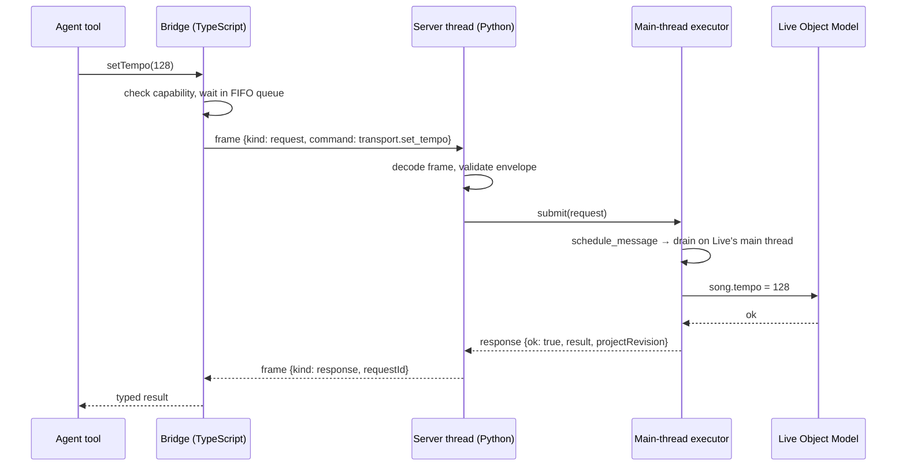

# Live Connection

This page explains how the app talks to Ableton Live. A TypeScript **bridge**
in the app connects over a local TCP socket to a small Python program running
inside Live, called the **Remote Script**. Every read or edit an agent makes in
Live goes through this one connection.

## Key terms

| Term                       | Meaning                                                                                                                                                                                                                       |
| -------------------------- | ----------------------------------------------------------------------------------------------------------------------------------------------------------------------------------------------------------------------------- |
| **Remote Script**          | A Python package that Live loads as a "Control Surface" (the same mechanism used for hardware controllers). Ours is `remote-script/AbletonAgent`. It runs inside Live's embedded Python, so it has no third-party libraries. |
| **LOM**                    | The **Live Object Model**: Live's object API (`Song`, `Track`, `ClipSlot`, `Clip`, `Device`, `DeviceParameter`, …). The Remote Script reads and changes Live only through the LOM.                                            |
| **Main thread**            | Live only allows LOM access from its own main thread. Socket I/O runs on a background thread, so work has to be handed over.                                                                                                  |
| **Bridge**                 | `packages/bridge`: the TypeScript client that owns the socket, the handshake, timeouts, and reconnects.                                                                                                                       |
| **Live Set**               | One open `.als` document in Live. A **Live Project** is the folder (containing `Ableton Project Info`) that a saved Set may live in.                                                                                          |
| **Session / Arrangement**  | Live's two views: the Session grid of clip slots and scenes, and the Arrangement timeline.                                                                                                                                    |

## The pieces

```text
agent tools / Desktop UI
        │  calls typed methods (AbletonService)
        ▼
packages/bridge  ── loopback TCP, length-prefixed JSON ──►  remote-script/AbletonAgent
                                                             server → executor → command handler → LOM
```

- `packages/ableton-contracts` defines `AbletonService`: the domain-level
  interface (`inspectSession`, `setTempo`, `createTrack`, …) that tools and the
  application call. They never build raw socket messages.
- `packages/bridge` implements it as `AbletonBridgeService`.
- `packages/protocol` holds the shared wire contract: Zod schemas for every
  envelope, the command catalog (`src/catalog.ts`), framing, and the protocol
  version. The Python side mirrors this by hand.

TypeScript owns the schemas. The Python script validates the same shapes
without any dependencies. `packages/protocol/scripts/generate-contracts.mjs`
writes JSON Schema and fixtures into `packages/protocol/contracts/`, which the
Python tests read. `scripts/check-protocol-compatibility.mjs` flags breaking
changes. See [ADR 0004](decisions/0004-typescript-python-schema-ownership.md).

## The wire protocol

The transport is plain TCP on `127.0.0.1`, port `8765` by default. The Remote
Script binds only to loopback, so nothing outside the machine can connect. See
[ADR 0002](decisions/0002-loopback-framed-tcp.md).

**Framing.** Each message is a 4-byte unsigned big-endian length followed by
that many bytes of UTF-8 JSON. Frames are capped at 4 MiB. Zero-length,
oversized, or malformed frames close the connection. Code:
`packages/protocol/src/framing.ts` and `remote-script/AbletonAgent/protocol.py`.

**Envelope.** Every message has `protocolVersion` and a `kind`:

| `kind`     | Sent by       | Main fields                                                                                    |
| ---------- | ------------- | ---------------------------------------------------------------------------------------------- |
| `request`  | bridge        | `requestId` (UUID), `command` (e.g. `tracks.create`), `params`                                 |
| `response` | Remote Script | same `requestId`, then `ok: true` + `result`, or `ok: false` + `error { code, message, retryable }` |
| `event`    | Remote Script | `event` name, increasing `sequence`, `payload`                                                 |

Responses and events can also carry `projectRevision` (see
[Project State](project-state.md#revisions)). Error codes are a small fixed
set in `protocolErrorCodeSchema`, such as `stale_reference`, `queue_full`,
`lom_error`, and `applied_indeterminate`.

**Version.** There is one protocol version number, generated by
`scripts/generate-product-versions.mjs` into both
`packages/protocol/src/version.generated.ts` and
`remote-script/AbletonAgent/version.py`. Both sides must agree exactly; there
is no fallback to older versions.

### Handshake and authentication

The first request on a new connection must be `system.hello`. It contains:

- an **authentication token** (at least 32 characters);
- the protocol versions the app supports;
- the app version;
- the event names the app wants to receive.

The Remote Script creates the token the first time it loads and saves it as
`.ableton-agent-token` next to its own files (`token_store.py`). The app reads
that file from the installed Remote Script folder in Live's User Library, or
from the `ABLETON_AGENT_TOKEN` environment variable
(`apps/desktop/src/main/bridge-credentials.ts`).

If the token and version match, the reply is a **capability document**: Live
version, Remote Script version, the current Live Set identity, a map of
supported capabilities, and limits such as the maximum frame size. The bridge
checks capabilities before sending a command, so unsupported features fail
early with a clear error instead of a LOM exception. Any other request before
a successful hello is rejected.

### Requests, queueing, and timeouts

The bridge sends **one request at a time**. Calls wait in a FIFO queue (up to
128 entries, then `queue_full`). The next request is only sent after the
previous response arrives. This keeps edits to Live strictly ordered.

Each command in the catalog has a **timeout class**:

| Class    | Default | Used for                                                               |
| -------- | ------- | ---------------------------------------------------------------------- |
| `normal` | 5 s     | Most reads and edits.                                                  |
| `long`   | 15 s    | Heavier work, e.g. `devices.inspect_parameters`, `arrangement.fill_region`. |

The clock starts when the request is **sent**, not when it is queued. If a
read times out, it fails as retryable. If an edit times out, the app can't
know whether Live applied it. So the error is marked **not** retryable, and
the bridge drops the connection. The agent should re-inspect
Live before trying again.

### Reconnects

If the socket closes, pending requests fail and the bridge retries with
backoff (5 attempts, 250 ms growing to 4 s, with jitter). After reconnecting,
it repeats the handshake and re-installs any Live Event subscriptions (see
[Live Events](live-events.md)). The Remote Script serves one client at a time.
When a client disconnects, it clears that client's subscriptions.

### Tracing

The trace and correlation IDs are **not** sent over the wire. The bridge
records each request's queued, dispatched, completed, failed, and timed-out
stages in the local journal. It tags each stage with the caller's trace ID
(from `@ableton-agent/correlation`) and the `requestId`. See
[Observability](observability.md).

## One request, end to end



## Inside the Remote Script

All files are in `remote-script/AbletonAgent/`.

| File                    | Role                                                                                                                                                                         |
| ----------------------- | ---------------------------------------------------------------------------------------------------------------------------------------------------------------------------- |
| `control_surface.py`    | Entry point Live loads. Builds everything below, starts it, and tears it down in `disconnect()`.                                                                            |
| `server.py`             | Background socket thread. Accepts one loopback client, decodes frames, handles `system.hello`, and forwards other requests to the executor. It also sends events.           |
| `registry.py`           | `CommandRegistry`: maps a command name to a handler, plus metadata (`mutates`, `capability`, `timeout_class`, optional `validator`).                                      |
| `executor.py`           | `MainThreadExecutor`: a bounded queue (128) drained on Live's main thread via `schedule_message`, at most 8 commands per tick.                                              |
| `*_commands.py`         | Command handlers grouped by area: `system_commands.py`, `core_domain_commands.py`, `device_commands.py`, `browser_commands.py`, `workflow_adapter_commands.py`, listening commands, and more. Each has a `register_*` function. |
| `capabilities.py`       | Builds the capability document by probing what this Live version exposes.                                                                                                    |
| `identity.py`           | Computes Live Set and Live Project identity.                                                                                                                                 |
| `listeners.py`          | Fixed LOM listeners for tempo, transport, tracks, scenes, selection, and similar Set-wide state.                                                                                     |
| `event_subscriptions.py`| Dynamic, user-defined Live Event listeners. See [Live Events](live-events.md).                                                                                               |
| `save_observer.py`      | Detects when the Set is saved.                                                                                                                                               |

**Executor.** A handler returns a value, raises `ProtocolFailure` (a typed
error), or raises any other exception, which becomes `lom_error`. Long jobs
return a `DeferredResult`. These run across several Live ticks and reply when
they finish, so the main thread is never blocked for long.

**Object references.** The LOM has no stable IDs. The script hands out
**runtime references**: random UUIDs remembered for each live object until the
script restarts. Edits usually send `index`, `expectedReference`, and
`expectedName`. If they don't all match the current object, the command fails
with `stale_reference` instead of changing the wrong thing.

### Live Set identity

`identity.py` gives every Set a `liveSetId`:

- **Saved Set:** a hash of the `.als` file path, so it is the same each time the
  file is opened.
- **Unsaved Set:** a random ID kept for the lifetime of that in-memory Set.

For a saved Set, the script walks up from the file to the nearest folder that
contains `Ableton Project Info` and uses it as the Live Project. File paths are
never sent to the app. `live_set.get_identity` returns the same data on
demand.

### Save observer

`save_observer.py` checks the saved file's modified time and size about once a
second. It never opens or reads the file. When the values change and stay
stable for two samples, it sends `live_set.save_observed` with the full Set
identity. The `firstSave` flag means an unsaved Set was just saved for the
first time, so its `liveSetId` changed from random to path-based. Save As is
handled the same way. Opening a different Set resets the baseline, so it is
not mistaken for a save.

## Where to look in the code

| What                                   | Where                                                   |
| -------------------------------------- | ------------------------------------------------------- |
| Domain interface used by tools         | `packages/ableton-contracts/src/index.ts`               |
| Bridge (queue, timeouts, reconnect)    | `packages/bridge/src/index.ts`                          |
| Envelopes, hello, capability schemas   | `packages/protocol/src/schemas.ts`                      |
| Command catalog and timeout classes    | `packages/protocol/src/catalog.ts`                      |
| Framing                                | `packages/protocol/src/framing.ts`                      |
| Generated cross-language contracts     | `packages/protocol/contracts/`                          |
| Remote Script entry point              | `remote-script/AbletonAgent/control_surface.py`         |
| Socket server and handshake            | `remote-script/AbletonAgent/server.py`                  |
| Main-thread executor                   | `remote-script/AbletonAgent/executor.py`                |
| Token loading in the app               | `apps/desktop/src/main/bridge-credentials.ts`           |
| Python tests and LOM simulator         | `remote-script/tests/`, `remote-script/simulator.py`    |
