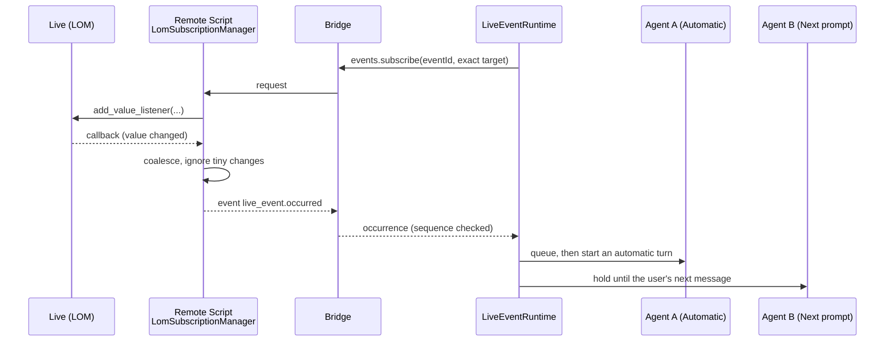

# Live Events

A **Live Event** is a watch on one thing in Ableton Live, such as "the Filter
Cutoff knob on the Bass track" or "which clip is playing on the Drums track".
When it changes, the Remote Script sends an event, and the app passes it to
any agents that listen to that event. This lets agents react to what you do in
Live without needing a Max for Live device. (**Max for Live** is Ableton's
system for building custom devices; the app uses Max for Live devices for
[Outputs and listening](listening.md), but not for Live Events.)

## Live Events vs. Outputs

These two features look similar but are separate:

|                  | Live Events                                              | Outputs                                                            |
| ---------------- | -------------------------------------------------------- | ------------------------------------------------------------------ |
| Source           | LOM listeners in the Python Remote Script                | MIDI or audio streams sent by Max for Live producer devices        |
| What arrives     | A semantic change: "value went from 0.4 to 0.7", "clip 3 started" | Observations: MIDI notes, audio measurements                       |
| Desktop view     | **Wiring**                                               | **Outputs**                                                        |
| Code             | `packages/runtime/src/live-event-runtime.ts`             | `packages/signal-routing`, `packages/runtime/src/signal-runtime.ts` |

They share the same ideas, though: one source can feed many agents, and each
agent decides how it wants to be told.

## Event kinds

There are five kinds today:

| Kind                            | Class      | Fires when                                                          |
| ------------------------------- | ---------- | ------------------------------------------------------------------- |
| `parameter.value_changed`       | continuous | A device parameter or rack macro moves.                             |
| `track.playing_clip_changed`    | discrete   | A track switches Session clip, starts Arrangement playback, or stops. |
| `track.triggered_clip_changed`  | discrete   | A track queues a clip launch (or a stop).                           |
| `track.recording_state_changed` | discrete   | A track or its clip starts or stops recording.                      |
| `track.pattern_changed`         | discrete   | A Machine Listening monitor finds, changes or loses a pattern.      |

The first four come from LOM listeners in the Remote Script. Pattern events
come from the app's monitoring loop instead ([Listening](listening.md)).

**Continuous** sources can fire many times a second, so only the latest value
matters. **Discrete** sources are transitions, so every one is kept in order.

## The data model

Two records describe Live Events. Both are in
`packages/agent-config/src/schemas.ts`.

- **`LiveEventDefinition`**: what to watch. It has an ID, a name, the kind,
  the owning Live Set (`projectId`), and a **target**. The target is stored
  by name plus occurrence (for example "the 2nd track named `Bass`"), because
  LOM object references don't survive a Live restart. Parameter events also
  have an `observationPolicy` (a minimum change size and a throttle).
- **`AgentEventListener`**: one agent's interest in one event. It has a
  `responseMode` (`automatic` or `next-prompt`), an optional message prefix,
  and optional prepared-context settings. Listeners live on each active agent
  instance, and can also be part of an agent definition.

One definition can have any number of listeners. Fan-out happens in the app;
Live gets only one LOM listener per event, however many agents listen.

## How an event flows

### 1. Subscribing (Remote Script)

`remote-script/AbletonAgent/event_subscriptions.py` contains
`LomSubscriptionManager`. It handles these commands:

| Command                      | Purpose                                                            |
| ---------------------------- | ------------------------------------------------------------------ |
| `events.inspect_selection`   | What track/device/parameter is selected in Live (for "watch selected"). |
| `events.subscribe`           | Resolve an exact target and add the LOM listener.                  |
| `events.unsubscribe`         | Remove one listener.                                               |
| `events.list_subscriptions`  | List what is installed.                                            |
| `events.clear_subscriptions` | Remove everything.                                                 |

`events.subscribe` needs the current `liveSetId` and the exact
index, reference, and name of the target (see
[Live Connection](live-connection.md#inside-the-remote-script)). If anything
doesn't match, it fails instead of guessing. The reply includes the starting
state.

When Live calls back, the manager turns the raw LOM values into readable
states. For example, `playing_slot_index = -2` becomes
`{ state: "arrangement" }`. Then it sends a `live_event.occurred` event with
the previous state, current state, and a short summary.

- **Parameter changes** are coalesced over a couple of Live ticks. Changes
  smaller than the minimum normalized change (0.001 by default) are dropped.
- **Discrete changes** are sent only if the state really changed.
- If the target is deleted or replaced (track removed, device swapped), the
  listener is removed and `live_event.invalidated` is sent with a reason.
- There are at most 256 dynamic subscriptions. All of them are cleared when the
  app disconnects or the script shuts down.

This is separate from `listeners.py`, which holds a fixed set of Set-wide
listeners (tempo, transport, tracks, scenes, selection, routing, meters). They
send `live_set.changed` and `live_state.changed`. Those keep the app's view of
the Set current. They aren't user-defined events.

### 2. Transport and reconnect (bridge)

The bridge checks that event `sequence` numbers increase by one. A gap
publishes `ableton.event_gap` and triggers reconciliation. The bridge
remembers which subscriptions the app wants. After a reconnect it installs
them again and reports which ones could not be resolved.

### 3. Fan-out and delivery (runtime)

`DefaultLiveEventRuntime` in `packages/runtime/src/live-event-runtime.ts`
connects the bridge to the agents:

- It re-resolves each enabled definition by name with `session.inspect` and
  device reads, then calls `events.subscribe`. If that fails, it retries a few
  times. If it still fails, the event is marked **unresolved** (for example,
  missing or ambiguous).
- For each occurrence, it finds the listeners for that event. It skips agents
  that aren't active and creates one **delivery** per listener.
- A "triggered clip cleared" transition is recorded but not sent to agents,
  because there is nothing to act on.

## Delivery modes

Each listener picks one mode in the **Wiring** view.

### Next prompt

The event waits until the user next sends that agent a message. It is then
attached as hidden context (`<live-event-context hidden="true">`), marked as
observations, not user requests. The context is built by
`constructNextPromptLiveEventContext` in
`packages/application/src/live-event-delivery.ts`.

- Continuous events keep only the latest value per listener.
- Discrete events keep an ordered list, up to 32 per agent; older ones are
  dropped.
- At most 16 events or about 12,000 characters go into one prompt.

### Automatic

The event starts an agent turn by itself. The runtime queues it per agent,
and the application runs it with `enqueueLiveEventTurn` in
`packages/application/src/index.ts`:

- The prompt is wrapped in `<live-event-trigger>` so the agent knows Live
  triggered it, not the user. The listener's message prefix comes first.
- The turn runs in that agent's own Copilot session. It waits behind any turn
  already running for that agent, and uses that agent's normal tool rules and
  approvals.
- Continuous events wait about 120 ms for the value to settle, then send only
  the latest one. Discrete events are sent in order, up to 128 waiting per
  agent.
- Listeners can attach **prepared context**: a cached, bounded summary of the
  Set (`packages/runtime/src/prepared-context.ts`). The agent can then act
  without inspecting Live first. The cache refreshes in the background when
  the Set changes.

## The Wiring view

The Desktop **Wiring** tab (`apps/desktop/src/renderer/WiringView.tsx`) is a
node graph. Sources sit on the left, active agents on the right, and a wire is
one `AgentEventListener`.

- **Sources** come in two shapes so they are easy to tell apart. A
  **monitor** card (wave icon, ARMED/OFF toggle, track colour strip) is a
  Machine Listening device; it is a `track.pattern_changed` event underneath.
  A **Live event** tag (bolt or knob icon) is any other event kind.
- **Agents** are cards with their colour as a header. Configured but inactive
  agents are hidden; **Add agent…** starts one.
- **Wires** are solid for automatic ("Start a turn now") and dashed for next
  prompt ("With my next message"). Drag from a source's port to an agent to
  connect. Clicking a wire's badge opens it in the inspector: mode, which
  changes to tell it about (monitors), the appended prompt (the listener's
  `messagePrefix`), and prepared context under **Advanced**.
- **Add listener…** loads the Machine Listening device from the User Library
  onto the end of a track's chain (`packages/runtime/src/listener-device.ts`). **Add event…** watches a clip change or a
  knob. The knob search matches every word against track, device and
  parameter names, groups results by track and device, can show rack macros
  only, and hides unnamed macros and on/off switches until asked.
- **Arm all** (also in the top bar) arms every monitor; each monitor card has
  its own toggle. Agents can still arm monitors with tool calls; both paths
  share one set of armed tracks ([Listening](listening.md)).
- **History** searches the local event journal. You can follow an
  occurrence's trace through fan-out and delivery to each agent.

Wiring is the only place agents are connected to events and monitors.
Agent definitions don't carry connections; an agent starts with none when it
is added to a session.

Every step (subscribe, occurrence, fan-out, queue, settle, delivery) is
recorded as an observability event with the occurrence ID as its trace. See
[Observability](observability.md).

## Output routing to multiple agents

Outputs follow the same "one source, many agents" pattern, using
`packages/signal-routing`:

- A **producer** is a MIDI or audio source with a stable `producerId`, usually
  a Max for Live device. Producers connect to the app's signal ingress server
  (`ingress-server.ts`), a loopback TCP server using newline-delimited JSON.
- An **assignment** (`OutputAssignment` in `contracts.ts`) links one producer
  to one agent instance. It has a delivery mode, an enabled flag, and a usage
  instruction.
- `SignalRouter` (`router.ts`) gives every assignment its own bounded inbox.
  One incoming frame is copied into each enabled assignment's inbox. Replays
  and exact duplicates are filtered out first.
- Delivery modes are `next-prompt`, `automatic-analysis` (a turn that may only
  inspect, with no edits), and `automatic-action` (a turn that may edit, with
  normal approvals).
- If a producer disconnects, its assignments stay. Delivery resumes when the
  same `producerId` comes back.

In the **Outputs** view, each Output has one checkbox per active agent. The
same subscriptions also appear in the agent editor. For capture and analysis
details, see [Listening](listening.md).

## Where to look in the code

| What                                     | Where                                                   |
| ---------------------------------------- | ------------------------------------------------------- |
| Definition and listener schemas          | `packages/agent-config/src/schemas.ts`                  |
| Wire schemas for subscriptions/occurrences | `packages/protocol/src/schemas.ts`                    |
| LOM listeners for Live Events            | `remote-script/AbletonAgent/event_subscriptions.py`     |
| Fixed Set-wide listeners                 | `remote-script/AbletonAgent/listeners.py`               |
| Sequence checks and resubscribe          | `packages/bridge/src/index.ts`                          |
| Fan-out, queues, settle, retries         | `packages/runtime/src/live-event-runtime.ts`            |
| Prompt formatting                        | `packages/application/src/live-event-delivery.ts`       |
| Automatic turns                          | `packages/application/src/index.ts` (`enqueueLiveEventTurn`) |
| Prepared context cache                   | `packages/runtime/src/prepared-context.ts`              |
| Output routing                           | `packages/signal-routing/src/router.ts`, `contracts.ts` |
| Wiring UI                                | `apps/desktop/src/renderer/WiringView.tsx`              |
| Outputs UI                               | `apps/desktop/src/renderer/App.tsx`                     |
