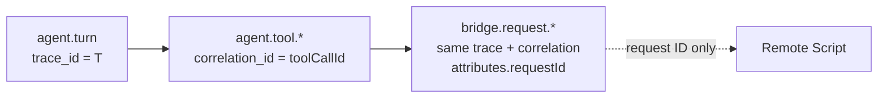

# Observability

When something goes wrong in a user session, this page tells you where to
look. The app records what happened locally, in a few places, and links the
records together with trace and correlation IDs. Nothing is uploaded: every
file below stays on the user's machine.

All paths are under `~/.live-agent/profiles/{profile}/` (usually `default`; dev
builds use `development`). See [Storage](storage.md) for the full layout.

## What gets recorded

| Source | Path | What is in it | Written by |
| --- | --- | --- | --- |
| **Journal** (main source) | `observability/agent-set-event-history.sqlite` | Every app lifecycle event, plus agent and Live Set history | `packages/observability`, fed by Desktop and the runtime |
| **Copilot transcript** | `copilot/session-state/{sdk-session-id}/events.jsonl` | The SDK's own event stream: user/assistant messages, tool start/complete, permission requests, compaction, usage | Copilot SDK (not our code) |
| **Desktop log** | `logs/desktop.log` | JSON lines (`timestamp`, `level`, `message`, `context`) for startup, settings, errors | `apps/desktop/src/main/logger.ts` |
| **Remote Script log** | Live's `Log.txt` (in `~/Library/Preferences/Ableton/Live 11.x/`) | Messages from the Python Remote Script via `log_message` | `remote-script/AbletonAgent/control_surface.py` |
| **CLI run trace** | Path you pass to `ableton-agent run --trace PATH` | One JSON summary of a CLI run | `apps/cli/src/run-trace.ts` |

The CLI does not write the journal or `desktop.log`; only Desktop does.

### Inside the journal

The journal is a SQLite file (driven by `sql.js` in a worker thread,
`packages/observability/src/journal.ts`). It has three groups of tables:

| Table(s) | Contents |
| --- | --- |
| `app_events` | One row per lifecycle event. The table you will use most. |
| `app_configuration_snapshots` | Sanitized agent configuration when an agent is created or changed. |
| `agent_sessions`, `agent_turns`, `agent_messages`, `agent_tool_calls`, `agent_tool_results`, `agent_approvals` | Agent conversation history. |
| `set_saves`, `set_snapshots`, `set_trajectory_records` | Live Set saves, snapshots, and what changed. |

Easier-to-read **views** sit on top: `agent_history_*` (for example
`agent_history_tool_results`) and `set_history_*` (for example
`set_history_tracks`). The agent's own `ableton_live_history` tool can query
these views read-only (`packages/tools/src/set-sql-search.ts`).

Useful `app_events` columns:

| Column | Meaning |
| --- | --- |
| `sequence` | Insert order. Sort by this. |
| `occurred_at` | ISO-8601 UTC time, e.g. `2026-11-20T22:44:31.583Z`. |
| `name` | Event name, `area.thing.stage`, e.g. `bridge.request.failed`. |
| `source` | Producer, e.g. `agent-runtime`, `ableton-bridge`, `desktop`, `output-ingress`. |
| `stage`, `level`, `outcome` | Lifecycle stage (`queued`, `started`, `progress`, `completed`, `failed`, `cancelled`, …), `debug`–`error`, and `success`/`failure`/`cancelled`/`unknown`. |
| `trace_id`, `span_id`, `parent_span_id`, `root_trace_id` | Trace tree (see below). |
| `correlation_id`, `causation_id` | Links to the tool call and the thing that caused it. |
| `session_id`, `live_set_id`, `active_agent_id`, `tool_name` | Who and what. `session_id` is usually the Copilot SDK session ID. |
| `duration_ms` | Stage duration when known. |
| `payload` | Full JSON envelope. Extra details are under `$.attributes`. |

Common event families: `agent.*` (turns, assistant text, tools, permissions),
`bridge.request.*` (queued → dispatched → completed/failed),
`bridge.event.*` (events from Live), `listening.*` and `output.*` (audio
listening and Max for Live signals), `project-context.*`, `desktop.*`.

## Trace and correlation IDs

IDs connect one user prompt to everything it caused:

- **Trace** (`trace_id`): roughly one agent turn. Spans form a tree:
  turn → tool call → bridge request. The runtime builds these in
  `packages/runtime/src/composition.ts`.
- **Correlation** (`correlation_id`): inside a tool, this is the SDK's
  **tool call ID**. `packages/correlation` stores it in Node's
  `AsyncLocalStorage`, so any code running under the tool (for example the
  bridge in `packages/bridge/src/index.ts`) can read it without passing it
  through every function.
- **Causation** (`causation_id`): what triggered this record, such as the turn
  ID for a tool call.



The wire request to the Remote Script carries a `requestId`, not the trace.
To follow a call into Live, use `json_extract(payload, '$.attributes.requestId')`
from the `bridge.request.*` rows.

## Redaction and limits

Two sanitizers protect what is written:

- **Journal**: `packages/observability/src/sanitizer.ts`. It runs when the
  event is enqueued and again in the writer. It replaces credential fields
  (`token`, `password`, `authorization`, …) and token-like strings (Bearer
  headers, GitHub tokens, private keys, passwords in URLs) with `[REDACTED]`.
  Binary and audio data become `[Binary data omitted]` / `[Audio data omitted]`.
  Strings, arrays, and nesting depth are bounded. Prompts, assistant text, file
  paths, MIDI, and tool arguments/results are kept on purpose, so the journal
  is a useful history.
- **Desktop log**: `apps/desktop/src/main/logger.ts` redacts credential keys
  and tokens and truncates long strings.

The Copilot `events.jsonl` files are written by the SDK and are **not**
passed through our sanitizer. Treat them as sensitive.

Retention:

| Store | Default limit |
| --- | --- |
| Journal | 30 days and 250 MiB, oldest removed first. Adjustable in the History view. |
| `desktop.log` | Pruned at startup: deleted after 14 days, trimmed above 5 MiB. |

Recording never blocks the app: `createNonBlockingObservabilityRecorder`
(`packages/observability/src/recorder.ts`) queues events and reports write
failures separately.

## The History view

In Desktop, open **Events → History**. It lists traces newest first, with
filters for event names, sources, level, outcome, and time range. Click a trace
to see each event in order with timings. You can also delete a trace, clear
history, prune, and change retention there. **Diagnostics** has _Reveal log_
and _Export support bundle_ (a redacted JSON file with the last 500 log lines).

The renderer only gets typed, redacted view models through IPC
(`event-history:*` channels in `apps/desktop/src/main/ipc.ts`); it has no
direct SQL or file access.

## Recipe: investigating a failed user session

1. **Get the time.** Ask roughly when it failed. Check the History view first;
   filter Outcome = failure.
2. **Open the journal read-only.** Use the SQLite CLI. Quit Desktop first or
   copy the file, because the app rewrites it while running.

   ```sh
   sqlite3 -readonly ~/.live-agent/profiles/default/observability/agent-set-event-history.sqlite
   ```

3. **Find failures in the window.**

   ```sql
   SELECT occurred_at, name, source, tool_name, trace_id, correlation_id
   FROM app_events
   WHERE occurred_at BETWEEN '2026-11-20T21:00:00Z' AND '2026-11-20T23:00:00Z'
     AND (level = 'error' OR outcome = 'failure')
   ORDER BY sequence DESC
   LIMIT 50;
   ```

4. **Replay the whole trace** of the interesting row.

   ```sql
   SELECT occurred_at, name, stage, outcome, duration_ms,
          json_extract(payload, '$.attributes') AS attributes
   FROM app_events
   WHERE trace_id = '<trace_id from step 3>'
   ORDER BY sequence;
   ```

5. **Check the bridge.** Look for `bridge.request.failed` and read
   `$.attributes.command`, `$.attributes.errorCode`, and the timing fields
   (`queueWaitMs`, `executionDurationMs`, `timeoutMs`).

   ```sql
   SELECT occurred_at,
          json_extract(payload, '$.attributes.command')   AS command,
          json_extract(payload, '$.attributes.errorCode') AS error_code
   FROM app_events
   WHERE name LIKE 'bridge.request.%' AND outcome = 'failure'
   ORDER BY sequence DESC LIMIT 20;
   ```

6. **See what the tool returned to the model.**

   ```sql
   SELECT occurred_at, tool_name, action, outcome, error, result_json
   FROM agent_history_tool_results
   WHERE tool_call_id = '<correlation_id from step 3>';
   ```

7. **Read the conversation.** Find the SDK session, then open its transcript:

   ```sql
   SELECT app_session_id, agent_session_id FROM agent_history_sessions
   WHERE app_session_id = '<app session>' OR agent_session_id = '<session_id>';
   ```

   Then open
   `~/.live-agent/profiles/default/copilot/session-state/<agent_session_id>/events.jsonl`
   and search for the tool call ID (`toolCallId` in the `tool.execution_*`
   events).

8. **Still unclear?** Check `logs/desktop.log` around the same time, and Live's
   `Log.txt` for Remote Script errors.

## Where to look in the code

| Topic | File |
| --- | --- |
| Event envelope, limits, retention defaults | `packages/observability/src/contracts.ts` |
| Journal tables and views | `packages/observability/src/migrations.ts` |
| Journal writer and queries | `packages/observability/src/journal.ts`, `journal-worker.mjs` |
| Redaction | `packages/observability/src/sanitizer.ts` |
| Correlation context | `packages/correlation/src/index.ts` |
| Agent events → journal rows | `packages/runtime/src/composition.ts` |
| History view | `EventHistoryView` in `apps/desktop/src/renderer/App.tsx` |

Related: [Storage](storage.md), [Architecture](architecture.md),
[Live events](live-events.md).
