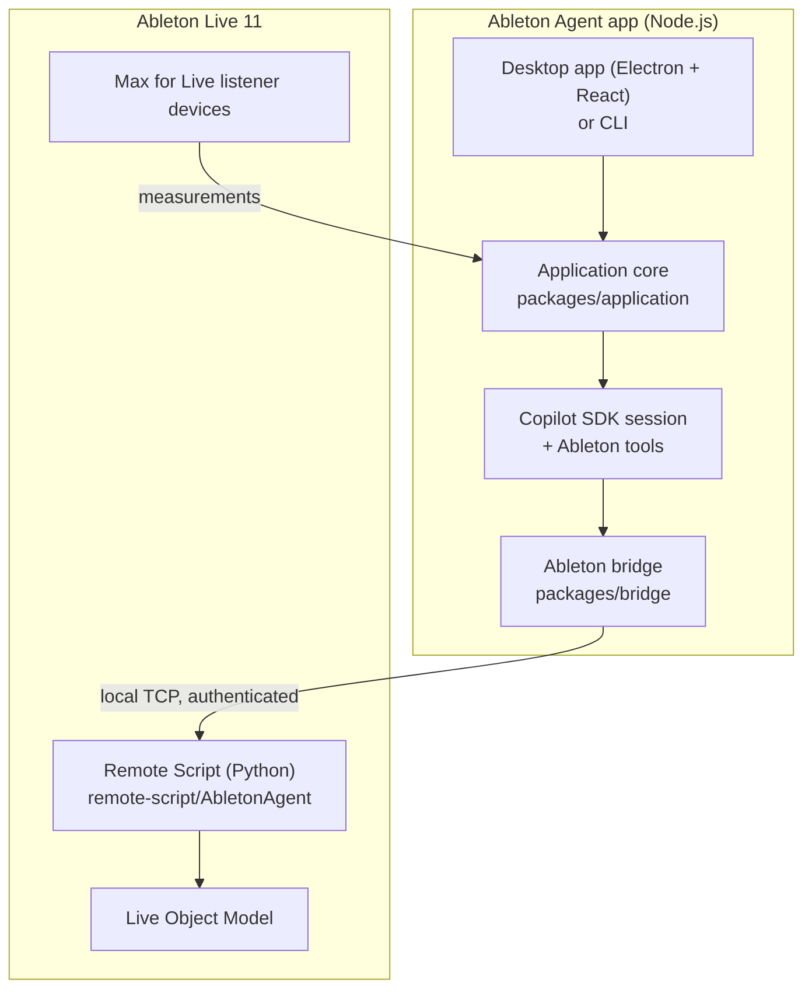

# Overview

Ableton Agent is a music-production assistant for Ableton Live 11. You chat
with an AI agent in a desktop app (or a terminal client). The agent can look
at your open Live Set, make changes to it, and even listen to clips, all
through typed, approval-gated tools.

The agent is powered by the [GitHub Copilot SDK](https://github.com/github/copilot-sdk).
The app is not an MCP server and doesn't use MCP to reach Live.

## The big picture

Three key words:

| Term | Meaning |
| --- | --- |
| **LOM** (Live Object Model) | Live's internal API for tracks, clips, devices and transport. It only exists inside Live's embedded Python. |
| **Remote Script** | A Python package Live loads at startup (like a controller script). Ours opens a local socket and runs commands against the LOM for the app. |
| **Max for Live device** | A device built in Max that runs inside Live. We use them to capture audio and MIDI, which the LOM can't provide. |

Because the LOM is only reachable from inside Live, the app needs the Remote
Script. Everything else (the agent, tools, storage, UI) runs in the app.

## One message, end to end

Say the user types "make clip-1 eight bars long".

1. **UI → core.** The desktop renderer sends the message over Electron IPC to
   the main process, which hands it to the application core
   (`packages/application`). The CLI calls the same core directly.
2. **Core → Copilot SDK.** The core owns a Copilot SDK session for the active
   agent (system prompt, allowed tools, skills). The message goes to the model.
3. **The model picks a tool.** It might first call an inspection tool to find
   clip-1, then a change tool to set its length.
4. **Policy and approval.** Before a tool runs, the app's policy hook checks it
   and, for anything that changes the Set, asks the user to approve. See
   [Safety](safety.md).
5. **Tool → bridge.** The tool handler (`packages/tools`, `packages/workflows`)
   validates its arguments and sends a typed request through the bridge.
6. **Bridge → Remote Script.** The request travels as a length-prefixed JSON
   frame over `127.0.0.1`. The Remote Script runs it on Live's main thread and
   replies. See [Live connection](live-connection.md).
7. **Result → model → user.** The tool result goes back to the model, which
   replies. The UI streams the reply and shows each tool call as it happens.
8. **Recorded.** Every step is written to the local event journal so you can
   look back at what happened. See [Observability](observability.md).

## What the agent can do

- Inspect the Set: tracks, clips, notes, devices, parameters, transport.
- Change it: create and edit tracks, clips and MIDI notes; set device
  parameters; load from Live's browser.
- Search Set history: a local SQL-searchable record of the Set over time.
- Listen: play a clip or Arrangement range and measure the audio with a Max
  for Live device. See [Listening](listening.md).
- React to Live: watch parameters or clip playback and notify agents. See
  [Live events](live-events.md).
- Run several specialized agents (compose, arrange, mix, sound design) with
  their own tools and skills. See [Agent](agent.md).

## Where to go next

Read [Architecture](architecture.md) for the repo map, then whichever concept
page matches what you're working on. The [docs index](README.md) lists them
all.
