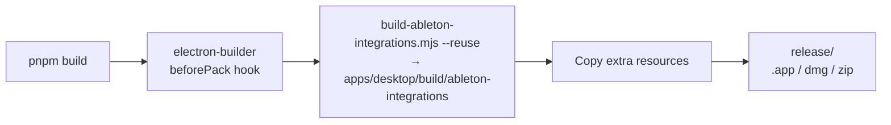

# Packaging and installation

Ableton Agent ships as three pieces that live in different places on your
machine: the desktop app, a Python Remote Script that Ableton Live loads, and
two Max for Live devices. This page explains how each piece is built, where it
gets installed, and how versions are kept in sync.

Two terms first:

- **Remote Script**: a Python package that Live loads as a "Control Surface".
  Ours (`remote-script/AbletonAgent`) runs inside Live, talks to the Live
  Object Model (LOM, Live's internal API), and listens for the app on
  `127.0.0.1:8765`. See [live-connection.md](live-connection.md).
- **Max for Live device** (`.amxd`): a Max patch packaged as a Live device you
  can drop on a track. Ours send MIDI and audio observations back to the app.
  See [listening.md](listening.md).

## What goes where

| Piece                     | Built from                                         | Installed to                                                                                     |
| ------------------------- | -------------------------------------------------- | ------------------------------------------------------------------------------------------------ |
| Desktop app               | `apps/desktop` + workspace packages                | `/Applications/Ableton Agent.app` (macOS)                                                        |
| Remote Script             | `remote-script/AbletonAgent`                       | `<User Library>/Remote Scripts/AbletonAgent/`                                                    |
| Machine Listening device  | `max-patches/audio-listener` (generated by script) | `<User Library>/Presets/Audio Effects/Max Audio Effect/Machine-Listening-Development/`            |
| MIDI Capture device       | `max-patches/midi-capture`                         | `<User Library>/Presets/MIDI Effects/Max MIDI Effect/Midi-Capture/`                               |
| App data                  | created at runtime                                 | `~/.live-agent/profiles/{profile}/` (see [storage.md](storage.md))                               |

The **User Library** is Live's per-user content folder. The installer detects
it in the standard macOS (`~/Music/Ableton/User Library`,
`~/Documents/...`) and Windows (Documents, OneDrive) locations. You can
override detection with `--user-library <path>` or the `ABLETON_USER_LIBRARY`
environment variable (`apps/desktop/src/main/remote-script-install.ts`).

The Max devices are copied into the User Library, but the installer does not
put them on a track. Insert them yourself from Live's browser.

## Building from source

```bash
npm install --global pnpm@10.15.1
pnpm run bootstrap      # pnpm install --frozen-lockfile && pnpm build
```

`pnpm build` compiles every workspace package plus the CLI and desktop app.
From there you can run the app in development (`pnpm desktop:dev`) without
packaging anything.

## Packaging the desktop app

```bash
pnpm desktop:dist
```

This runs `pnpm build` and then `electron-builder` with
`apps/desktop/electron-builder.yml`. Output goes to `release/` at the repo root.



Before packing, the `beforePack` hook (`apps/desktop/scripts/before-pack.cjs`)
runs `scripts/build-ableton-integrations.mjs --reuse`. That script builds the
Max device payload from the tracked sources into
`apps/desktop/build/ableton-integrations/`, with a hash manifest. With
`--reuse`, an existing payload is checked against its sources and refused if it
is stale or was modified; it is never silently rebuilt. After changing device
sources, delete the payload or run the script without `--reuse`.

The packaged app's `Resources/` folder then contains:

- `ableton-integrations/`: the two Max device bundles and their manifests.
- `remote-script/AbletonAgent/`: the Remote Script, without any token, install
  receipt, or `__pycache__`.
- `agents/` (`*.yaml`) and `skills/` (`SKILL.md`): the built-in agents and
  skills.

Targets: macOS `dmg` and `zip` for x64 and arm64; Windows `nsis` for x64. Only
macOS is built in CI (`.github/workflows/package-desktop.yml`). That job does
not sign the app.

## Installing on macOS

The usual way to install a local build on your own Mac is:

```bash
pnpm desktop:install:mac
```

`scripts/install-desktop-macos.mjs` does the whole thing:

1. Refuses to run if Ableton Agent or Ableton Live 11 is open. Quit both first.
2. Cleans and runs `pnpm check` plus the Electron Playwright tests (skip with
   `--skip-checks`, which only builds).
3. Builds the Max payload with `--reuse` and packages an unpacked `.app` for
   your machine's architecture.
4. Runs a quick packaged-app test.
5. Installs the Ableton integrations from the packaged app's resources: Remote
   Script plus both Max devices (`integrations update --confirm`).
6. Copies the app to `/Applications/Ableton Agent.app`, ad-hoc signs it, and
   restores the old copy if anything fails.
7. Runs an authentication smoke test and launches the app.

| Option                     | Effect                                                            |
| -------------------------- | ----------------------------------------------------------------- |
| `--skip-checks`            | Build only; skip `pnpm check` and Electron tests.                 |
| `--skip-remote-script`     | Install only the Max devices, not the Remote Script.              |
| `--skip-auth-smoke`        | Skip the authentication smoke test.                               |
| `--no-launch`              | Don't open the app at the end.                                    |
| `--user-library <path>`    | Install integrations into this User Library.                      |
| `--profile <name>`         | Configure the Max devices for this storage profile.               |

## Installing the Ableton pieces by hand

You can install the integrations without packaging the app. Both commands
need `--confirm` to make changes.

```bash
# Remote Script only
pnpm --filter @ableton-agent/desktop remote-script detect
pnpm --filter @ableton-agent/desktop remote-script install --confirm

# Remote Script + both Max devices
pnpm --filter @ableton-agent/desktop integrations detect
pnpm --filter @ableton-agent/desktop integrations install --confirm
```

`integrations` also takes `--components remote-script,machine-listening,midi-capture`
to pick a subset, and `--dry-run` to preview.

What the installer does for the Remote Script:

- On first install, it generates a random token in
  `AbletonAgent/.ableton-agent-token` (owner-only permissions).
- On update, it keeps the existing token and moves the old version into
  `Remote Scripts/.ableton-agent-backups/`.
- Without `--confirm` it changes nothing.

The desktop app reads that token file at startup, so there is nothing to copy.
The CLI needs it in `ABLETON_AGENT_TOKEN` (see [cli.md](cli.md)).

The Max devices are written as frozen `.amxd` files configured for one storage
profile. If you switch profile or machine, reinstall them.

Then in Live:

1. Fully quit and reopen Live. Toggling the Control Surface off and on does
   not reload Python code.
2. Open **Preferences > Link, Tempo & MIDI**, and pick **AbletonAgent** as a
   Control Surface.
3. Open the desktop app's **Diagnostics** tab and check the bridge and
   compatibility rows.

## Versioning

All version numbers live in one file, `config/product-versions.json`:

| Field                 | Meaning                                                          |
| --------------------- | ---------------------------------------------------------------- |
| `app`                 | Desktop app version (also in `package.json` files).              |
| `remoteScript`        | Remote Script version.                                           |
| `protocol`            | Bridge protocol version shared by TypeScript and Python.         |
| `database`            | Project-state schema version.                                    |
| `minimumRemoteScript` | Oldest Remote Script the app accepts.                            |
| `supportedLive`       | Minimum Live version per major version (Live 11 only).           |

`pnpm versions:generate` writes these into generated files:
`packages/shared/src/product-versions.generated.ts`,
`packages/protocol/src/version.generated.ts`,
`packages/project-state/src/version.generated.ts`, and
`remote-script/AbletonAgent/version.py`. `pnpm versions:check` (part of
`pnpm check` and CI) fails if any of them are stale.

When the app connects, `packages/shared/src/compatibility.ts` checks the Remote
Script's reply. The protocol number must match exactly, the Remote Script must
be at least `minimumRemoteScript`, and Live must be a supported Live 11
version. The desktop app reports a mismatch in the Diagnostics tab.

## Updates

There is no automatic updater. To update, rebuild and reinstall
(`pnpm desktop:install:mac`). Because the protocol must match exactly, update
the Remote Script whenever you update the app, then restart Live.

## Logging and diagnostics

Logs, the local event journal, and support bundles are covered in
[observability.md](observability.md).

## Where to look in the code

| Topic                                | Path                                                      |
| ------------------------------------ | --------------------------------------------------------- |
| Packaging config                     | `apps/desktop/electron-builder.yml`                       |
| Pre-pack payload hook                | `apps/desktop/scripts/before-pack.cjs`                    |
| Max device payload build             | `scripts/build-ableton-integrations.mjs`                  |
| Max device encoding helpers          | `packages/shared/src/max-device.ts`, `scripts/max-device-publisher.mjs` |
| macOS installer                      | `scripts/install-desktop-macos.mjs`                       |
| Remote Script installer              | `apps/desktop/src/main/remote-script-install.ts`, `remote-script-cli.ts` |
| Integrations installer               | `apps/desktop/src/main/ableton-integrations-install.ts`, `ableton-integrations-cli.ts` |
| Version source and generator         | `config/product-versions.json`, `scripts/generate-product-versions.mjs` |
| Compatibility check                  | `packages/shared/src/compatibility.ts`                    |
