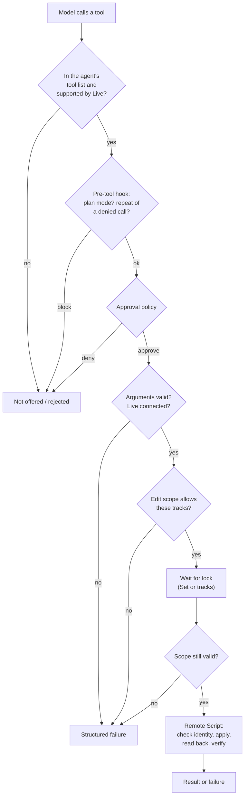

# Safety

The agent edits a user's real music project, so every change goes through
several checks before it reaches Ableton Live, and every change is read back
afterwards. This page explains how risky an operation is, what needs the
user's approval, what can be undone, and what happens when something fails.
For how tools are defined, see [tools.md](tools.md).

## Risk classes

Every operation has a `risk` in its descriptor
(`packages/tools/src/operation-descriptor.ts`):

| Risk          | Meaning                                                         | Examples                                                                                           |
| ------------- | --------------------------------------------------------------- | -------------------------------------------------------------------------------------------------- |
| `read`        | Looks at Live; changes nothing.                                 | inspect the Set, list tracks, search the Browser, query notes                                      |
| `reversible`  | A normal edit that can be changed back.                         | create or rename a track, set a parameter, set tempo, add notes, load a device                     |
| `destructive` | Deletes or replaces existing material.                          | delete a track, scene or clip; replace a clip's notes; remove notes; clear automation; prune stored analysis |
| `broad`       | Affects global Live state outside one object.                   | recording modes, Capture MIDI, Live undo/redo                                                       |

Destructive and broad calls with no arguments at all are rejected outright, so
they always name an explicit target.

## What needs approval

The Copilot SDK asks our permission handler before every tool call
(`createAbletonPermissionHandler` in `packages/tools/src/index.ts`). Reads are
approved immediately. Every other call (reversible, destructive or broad) goes
to the approval policy the user picked in Desktop preferences
(`ApprovalPolicyController` in `apps/desktop/src/main/approvals.ts`):

| Policy                     | Reads    | Writes                         |
| -------------------------- | -------- | ------------------------------ |
| **Risky changes** (default) | allowed | ask the user                   |
| **Always ask**             | ask      | ask the user                   |
| **Approve all**            | allowed  | approved without asking        |
| **Deny all changes**       | allowed  | denied                         |

On top of this, each active agent has an **auto-approve** switch (the
`autoApprove` field in its definition, or `/yolo` in the composer). It only
matters under "Risky changes" or "Always ask", where it approves that one
agent's requests without a prompt. "Deny all changes" still wins. Approvals are
tied to the agent that asked, so one agent's auto-approve can't approve
another's request.

The approval card shows the operation title, a risk badge (low, medium, high),
and the arguments. The user can **Approve** or **Deny** that one call. If no
window can show the card, or the app is shutting down, the request is denied.

Some tools skip the prompt because they only touch app-owned files: `skill`,
`read_plan` and `write_plan`. The SDK's `bash` tool is checked by a separate
policy (`packages/application/src/shell-policy.ts`) that allows only a few
read-only commands (`grep`, bounded `head`/`tail`, `wc`, `jq`) on the
agent's own large-output files, and rejects everything else.

## The checks, in order

1. **Tool list.** The agent only sees tools and operations its definition
   allows and that Live reports as supported.
2. **Pre-tool hook** (`packages/application/src/agent-policy.ts`). Plan mode
   and automatic-analysis turns may not mutate. A call identical to one that
   was just denied, or that failed in a non-retryable way, is blocked.
3. **Approval**, as above. A call whose arguments don't match the schema skips
   the prompt and fails at the next step instead.
4. **Validation.** Arguments are parsed against the strict schema, and the
   tool checks that Live is connected.
5. **Edit scope** (`createAbletonMutationAuthorizer` in
   `packages/tools/src/mutation-policy.ts`). The allowlist is checked again. A
   track-scoped agent can only touch its bound tracks, and needs session scope
   for anything global. Missing, ambiguous, stale or cross-project track
   bindings block the edit.
6. **Lock.** Session-wide edits lock the whole Set; track edits lock only their
   tracks. After the lock is granted, the scope check runs again.
7. **Remote Script.** The command checks the target's expected reference and
   name, refuses unsafe edits (for example deleting the last track or writing
   into an occupied clip slot), applies the change, and reads it back. Success
   means the new state was observed, not just that no error was thrown.

## Undo and rollback

There is **no atomic rollback** of a multi-step change. What exists:

- **Per-command restore.** Some Remote Script commands put things back if
  their read-back check fails. Examples: device parameter, device on/off,
  chain settings and device moves restore the old value; copying or filling
  Arrangement clips deletes any clips it created. If the restore itself
  fails, the failure says so (`rollbackError`, or outcome
  `applied_indeterminate`).
- **Live's own undo.** `ableton_live_history` can inspect, undo and redo. It is
  `broad`, and undo/redo also need the argument
  `confirmation: "global-live-history"`, because Live's history is shared with
  the user and may contain their edits too. The result always carries that
  warning. The app does not group its edits into undo steps.
- **Set History.** Saved snapshots and the log of agent actions can be queried
  later with `set_sql_search`, but they are a record, not a restore mechanism.

## When something fails

- Tool failures come back to the model as a structured result with a `code`,
  `message`, `retryable` flag and bounded details. The model is never handed a
  stack trace.
- The post-failure hook tells the model what to do. Denials, unsupported
  features and stale or ambiguous references are not retryable, and the
  identical call is blocked. For bad arguments the model is told to fix them
  from inspected state rather than resend them.
- `applied_indeterminate` means the edit may or may not have happened (for
  example Live stopped responding mid-command). The model is told not to retry,
  to inspect Live again, and to continue from what it sees.
- If a turn runs out of time, any edit still in flight is reported as
  `applied_indeterminate` for the same reason.
- Long jobs (timed slot recording, Looper export) keep their lock until they
  finish, fail or are cancelled. Only the agent that started a job can cancel
  it, and a job running when the Remote Script disconnects ends as
  `indeterminate`.
- Every step (requested, approved or denied, queued, started, completed,
  failed, cancelled) is recorded with its trace IDs so it can be reviewed later
  in Desktop History (see [observability.md](observability.md)).

## Where to look in the code

| Topic                              | File                                                          |
| ---------------------------------- | ------------------------------------------------------------- |
| Risk per operation                 | `packages/tools/src/operation-descriptor.ts`                  |
| Permission handler, failure format | `packages/tools/src/index.ts`                                 |
| Edit scope and locks               | `packages/tools/src/mutation-policy.ts`                       |
| Hooks and retry rules              | `packages/application/src/agent-policy.ts`                    |
| Shell policy                       | `packages/application/src/shell-policy.ts`                    |
| Approval policy and card           | `apps/desktop/src/main/approvals.ts`                          |
| Restore-on-failure in Live         | `remote-script/AbletonAgent/device_commands.py`, `system_commands.py` |
| Undo/redo command                  | `remote-script/AbletonAgent/workflow_adapter_commands.py`     |
