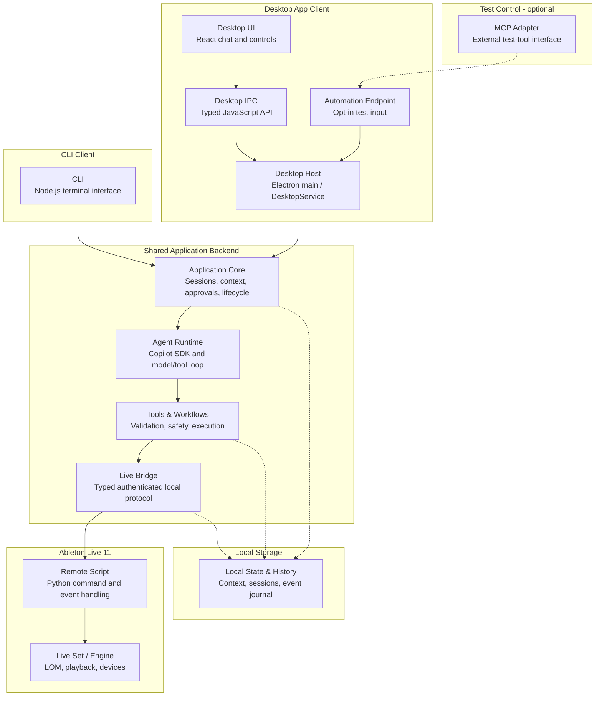

# Integration testing summary

The local `pnpm live:acceptance:suite` command discovers every registered packaged
acceptance scenario and runs each once, sequentially, using the existing driver.
It adds host ownership and aggregate candidate qualification, not a second
musical-test harness. `pnpm live:acceptance:verify` checks retained terminal
evidence against the exact candidate and current registry. See
[acceptance authoring](acceptance-authoring.md#run-every-registered-packaged-test-locally)
for execution and [packaging operations](../platform/packaging-and-operations.md#local-real-live-release-check)
for the release checklist. Ordinary hosted CI never launches Live.

This is the high-level guide to how our system fits together, which parts each
integration suite exercises, and how fixtures should be shared. Features such as
machine listening, MIDI editing, device control, and transport belong within
this map; they are not separate testing layers.

## 1. System architecture

### The big pieces

| Group | Plain-English role |
| --- | --- |
| **Desktop App Client** | The window-based way to use the product: screens, buttons, and the desktop-specific code behind them. |
| **CLI Client** | A separate terminal-based way to use the product. It is not inside the Desktop App Client and does not need Electron. |
| **Shared Application Backend** | The reusable machinery both clients use: conversations, the agent, safe operations, and the Live connection. This is broader than an "Agent Core": much of it works without asking a model anything. |
| **Local Storage** | The application's saved memory and activity record, accessed through application-owned services. |
| **Ableton Live 11** | The separate music application we control and inspect, including our Python Remote Script running inside it. |
| **Test Control** | Optional machinery for driving tests. It is not a required step in normal product use. |

These are logical responsibility groups, not separate servers. **Both clients
reuse the Shared Application Backend code**: Desktop hosts it through Electron
main; the CLI hosts it in its own Node.js process. They do not have to be running
together or share one running agent session. The Copilot runtime/model has its
own execution boundaries, abstracted by the Agent Runtime box below.

### How the pieces connect

This is a logical component diagram, not an exact operating-system process map.
Solid arrows show the main conversational request path. Results, approvals,
progress, and errors also travel back to the caller; return arrows are omitted
for readability.

The Automation Endpoint is inside the Desktop App Client because the running
app hosts it, but it is enabled only for explicit automation launches. A test
controller can call it directly; the optional MCP Adapter is not required.

### Each box, in plain English

| Component | What it does | Technology / shape |
| --- | --- | --- |
| **Desktop UI** | The part you see and touch: chat messages, Send, approvals, and progress. It asks for work rather than running the agent or accessing Live itself. | React + TypeScript, rendered in Electron's Chromium window. |
| **Desktop IPC** | The safe intercom between the screen and the privileged desktop code. The UI can request specific actions and receive updates, not execute arbitrary backend code. IPC means "inter-process communication." | A narrow JavaScript API exposed as `window.desktop`, backed by Electron preload, `contextBridge`, and IPC messages; TypeScript contracts and runtime validation. |
| **Desktop Host** | The desktop-side coordinator. It starts and connects backend services, accepts UI requests, and translates backend results/events into what the window needs. | TypeScript running in Electron's main process, including the `DesktopService` adapter. |
| **Automation Endpoint** | An opt-in side entrance that lets a test submit a message to the running Desktop Host without typing or clicking Send. | Authenticated local TCP request API on `127.0.0.1`; not a public web API and not the Desktop IPC API. |
| **CLI** | The terminal alternative to the desktop window: type messages, see responses, and handle approvals, or submit a scripted prompt. | Our TypeScript/Node.js command-line application. It calls Application Core directly, without Electron. |
| **Application Core** | The conversation coordinator. It manages sessions, supplies context, coordinates approvals and cancellation, and tracks work as it runs. | Client-independent TypeScript services running in Node.js. |
| **Agent Runtime** | The decision maker: interprets a request, asks the model what to do, and manages the conversation/tool loop. It does not reach into Live directly. | Application adapter + Node.js GitHub Copilot SDK, communicating with the Copilot runtime/model. That Copilot runtime is distinct from our CLI Client. |
| **Tools & Workflows** | The controlled actions the agent can choose. They check inputs and safety rules, then perform individual operations or planned sequences, with verification and cleanup where applicable. | Typed TypeScript functions and deterministic workflow code, not model-generated execution code. |
| **Live Bridge** | The messenger to Ableton: sends structured requests, matches replies, and handles connection state and Live events. | TypeScript/Node.js client using an authenticated, framed local TCP protocol. |
| **Remote Script** | Our small helper inside Ableton. It translates requests into allowed Live operations and schedules Live Object Model access on Live's main thread. | Python running inside Ableton Live's embedded runtime. |
| **Live Set / Engine** | The actual tracks, clips, devices, arrangement, and playback we want to inspect or change. LOM is the Live Object Model: Ableton's programmable view of these objects. | Ableton Live 11's host engine and exposed object APIs; not code owned by this repository. |
| **Local State & History** | The saved memory and notebook: conversation/session data, project context, settings, and records of what happened. It supports later retrieval and diagnosis. | Application-owned TypeScript storage/repository services over local files and SQLite, plus SDK-owned conversation data, under the shared profile layout. No renderer access to raw files or SQL. |
| **MCP Adapter** | A translator that exposes a test command such as "send this message" to an MCP-capable controller, then forwards it to the Automation Endpoint. | Separate TypeScript/Node.js process using MCP over standard input/output. Test tooling, not the agent's route to Live. |

**The App is not just the Agent Runtime.** It also owns conversation lifecycle,
context, approval handling, tools, the Live connection, persistence, and
presentation. The Agent Runtime chooses tools; application-owned code executes
validated operations.

The CLI enters at **Application Core**. The Automation Endpoint enters at
**Desktop Host**, bypassing **Desktop UI** and **Desktop IPC**. Neither runs the
React composer on the user's behalf. MCP is an optional adapter to that endpoint,
not a mandatory stage in the product.

**Local State & History** is a shared supporting boundary, not the last step of
every request. Dotted storage arrows summarize persistence and observability.
The diagram omits secondary status/event routes and feature-specific host
integrations such as Max for Live devices; it does not imply all application
reads require an agent turn or all audio data travels through the Remote Script.

## 2. Test suites mapped to the architecture

To keep the table readable, **Agent-to-Live path** means:

**Application Core → Agent Runtime → Tools & Workflows → Live Bridge →
Remote Script → Live Set / Engine.**

Read downward from complete product workflows to narrower integrations.
Rows 3a-3d are complementary slices, not strict subsets of one another.

| Suite | Real path / components exercised | What it leaves out or substitutes | Status and purpose | Command / location |
| --- | --- | --- | --- | --- |
| **1. UI-driven acceptance** | **Desktop UI → Desktop IPC → Desktop Host → Agent-to-Live path**, in the packaged app. Playwright operates actual controls. | Does not exercise Automation Endpoint or CLI input plumbing. | **Planned small suite:** prove representative user journeys work through the actual app, including visible approval/error behavior and independently verified outcomes. | Not implemented; no acceptance-suite command yet. |
| **2. Automation-driven acceptance** | **Automation Endpoint → Desktop Host → Agent-to-Live path**, in the packaged app, with the real Default agent. | Bypasses Desktop UI interaction and Desktop IPC submission. MCP is optional. | **First case qualified:** `session-clip-identify` passed twice in fresh owned environments, including independent capture/context/state assertions and cleanup. This is not broad listening or workflow qualification. | `pnpm test:acceptance:list`, `pnpm test:acceptance:validate`; explicit `pnpm live:acceptance --scenario <registered-id>`. See [authoring](acceptance-authoring.md). |
| **3a. CLI-driven integration** | **CLI → Agent-to-Live path**, with real agent and Live. | No Desktop UI, Desktop IPC, or Desktop Host. Many existing prompts are scenario-coached rather than ordinary Default-agent requests. | **Existing:** shared-backend workflow integration against the actual host. | `pnpm live:agent-smoke --scenario <id>` or `--group <id>`. Catalog: [suite.json](../../integration/live-scenarios/suite.json). |
| **3b. Programmatic runtime integration** | A harness starts at **Application Core**, **Tools & Workflows**, or **Live Bridge**, depending on the case, and exercises selected services against real **Remote Script → Live Set / Engine**. | No Desktop or CLI entry point. Some cases include Agent Runtime; others bypass agent decision-making. | **Existing:** targeted runtime/host behavior. Machine listening is one feature currently covered here, not a separate suite. | `pnpm live:agent-smoke --scenario <id>` or `--group <id>`. Same [catalog](../../integration/live-scenarios/suite.json). Native-listening groups require explicit reviewed fixture inputs. |
| **3c. Desktop integration** | **Desktop UI → Desktop IPC → Desktop Host**, plus the configured Application Core/service boundary. | Agent Runtime and Live dependencies are often replaced with fakes or injected responses. Check each test's setup. | **Existing:** UI, IPC, approvals, progress, errors, and recovery. A visible app window alone is not full-stack coverage. | `pnpm test:electron` (source mode). Tests: [desktop.spec.ts](../../tests/electron/desktop.spec.ts). |
| **3d. Packaged delivery integration** | Packaged **Desktop UI / Desktop Host** startup, bundled backend resources, native dependencies, installation, and selected authentication paths. | Does not generally drive the complete Agent-to-Live path or prove a musical task completed. | **Existing supporting lane:** prove the application ships and starts correctly. Some authentication checks are opt-in. | `pnpm test:electron:packaged`, after producing the required packaged artifacts. Tests: [packaged-desktop.spec.ts](../../tests/electron/packaged-desktop.spec.ts). |
| **4. Controlled subsystem integration** | Selected real boundaries: **Tools & Workflows ↔ Live Bridge interface**, **Live Bridge ↔ protocol peer**, or services ↔ **Local State & History**. | Fakes/simulators replace the host or agent as needed; temporary storage can exercise real persistence. | **Existing:** deterministic success, denial, failure, timeout, cancellation, and cleanup checks. Not physical Live qualification. | Targeted Vitest suites within `pnpm test:ts`, alongside unit tests. Identify each test's actual boundaries and substitutions. |

**`pnpm check` does not execute real-Live or Electron Playwright suites.** It
builds, runs quality/type/contract checks, and executes the standard test runners.
Electron tests are typechecked, not executed, by that command.

### What "coverage" means here

This table maps **execution scope**, not a blanket claim that every component or
feature is sufficiently tested. A component being loaded is not the same as its
behavior being exercised and asserted.

For each scenario, record three things: **the path exercised**, **the real versus
substituted dependencies**, and **the independently asserted outcomes**. For
example, a listening scenario can verify the exact source and capture in
**Live Set / Engine**, the answer from **Agent Runtime**, and durable context in
**Local State & History**. "The assistant said it worked" proves none of those by
itself.

**Our strategy:** broad feature coverage in automation-driven acceptance,
representative user journeys in UI-driven acceptance, and focused regression/
failure coverage at the owning lower boundaries. Share fixtures and assertions
between the two acceptance suites rather than duplicate the entire matrix.

Pure unit/component tests and static schema checks support this map but are not
classified as integration suites.

## 3. Shared fixtures and scenarios

**Share immutable starting worlds and test definitions, not mutable sessions.**
A fixture is the starting world; a scenario is what we ask the product to do
and how we judge the result; a driver is how the test interacts with the product.

### Current foundation versus target design

The existing [test-support](../../packages/test-support/src/index.ts) utilities
share fake application state, deterministic utilities, and generated audio. Existing
[staging](../../scripts/lib/native-listening-fixture.mjs) and
[provisioning](../../scripts/lib/saved-listening-fixture.mjs) helpers handle
reviewed real-Live listening projects. Some inputs are local/private rather than
portable fixtures.

**The new acceptance foundation is separate from those existing runners.**
Shared contracts live at `@ableton-agent/test-support/integration`; its catalog,
offline validation, and packaged automation adapter provide the new authoring
path. Existing runtime/CLI cases have not been migrated, and a real UI acceptance
adapter is still planned. The catalog now registers `session-clip-identify`
after joint fixture review; framework code or template validation is not physical
coverage. Its reviewed `.als` and original reference WAV are included directly
in Git, with provenance and hashes. Required licensed factory impulse responses
are pinned and verified in Live's Builtin installation, not redistributed.
Another checkout must obtain the exact reviewed inputs, not depend on files
that happen to exist on one developer's machine. Registration and actual
end-to-end qualification remain separate: use the terminal run receipts.
The first case has now passed twice on Live 11.3.43 (`run-c27nOv`,
`run-jTIy7p`, 2026-11-02), including persisted-context reads after an owned app
restart and full cleanup. Earlier failed attempts are retained. This does not
qualify automatic listener reconnection or another capture after restart; the
current native runtime intentionally requires reload after disconnect.

The follow-up workplan is tracked in
[epic #76](https://github.com/CooperNederhood/Ableton-Agent-App/issues/76):
same-session repetition, reconnect recovery, realistic launch states, contrasting
musical oracles, failure recovery, editing conversations, representative UI
journeys, collected-Set portability, and repeatable release qualification.
The epic records parallel workstreams and completion dependencies; these remain
follow-ups, not capabilities qualified by the first case.

| Shared piece | What belongs in it |
| --- | --- |
| **Fixture package** | A versioned starting project: `.als`, required audio/devices, resource hashes, dependency requirements, and a description of its expected starting state. Record the authoring Live 11 version without treating one patch version as a permanent support pin. |
| **Scenario definition** | A fixture reference, user messages, scoped permissions, and expected outcomes. Keep expected answers outside agent-visible prompts, filenames, and project metadata. Different scenarios can reuse one fixture. |
| **Verifier** | Independent checks of actual Live state, assistant output, application context/history, and cleanup. Read typed evidence through the appropriate adapter; do not ask the agent to grade its own work. |
| **Driver** | The entry-point-specific code: submit through Desktop UI, Automation Endpoint, CLI, or selected runtime services. Reuse fixture staging and applicable verifiers rather than duplicating them in each driver. |

### Build once, copy for each test

1. **Author and review.** Prepare the project in Live or use deterministic
   generators where appropriate. Include required original or licensed assets,
   verify its baseline, and publish an immutable fixture version. Fixture setup
   must not depend on the agent under test already succeeding at the behavior
   being tested. The developer-facing
   [`author-integration-test` skill](../../.github/skills/author-integration-test/SKILL.md)
   accepts a Set, desired actions, and correctness criteria, inspects only an
   owned copy, and asks for human contract review before freezing a persistent
   fixture/scenario. See [acceptance authoring](acceptance-authoring.md).
2. **Stage an isolated copy.** Each independent test gets a fresh working project
   and application profile, using the shared
   [storage contract](../platform/local-storage.md). Verify hashes, dependencies,
   and the loaded baseline before submitting messages. Missing or incompatible
   inputs block the run; do not silently repair or substitute the fixture.
3. **Run the conversation and assert.** Preserve project and conversation state
   across steps within that test. Use normal, scenario-scoped approvals and
   independent state reads. Message acceptance is not task completion.
4. **Clean up and preserve bounded evidence.** Close only test-owned processes.
   Retain allowlisted working-project resources for successful and failed runs
   under a bounded policy, not an entire working directory or authenticated
   profile. Write a durable checkpoint before pruning and require confirmed
   cleanup plus a durable final receipt for success. If cleanup fails, do not
   prune files needed for recovery. Retention limits block new runs rather than
   silently deleting earlier evidence.

### Sharing across suites

**UI-driven and automation-driven acceptance should use the same fixture
versions and scenario expectations.** The primary difference is how input enters
Desktop Host, plus UI-specific assertions for the UI-driven case.

CLI-driven and programmatic runtime integrations can reuse those fixture
packages and applicable verifiers when they test the same behavior. Controlled
subsystem tests reuse relevant data/builders without needing to load an entire
Ableton project. Reusing an expected MIDI pattern does not make a fake host
equivalent to real Live.

For example, one reviewed project could contain a kick clip under a neutral
name. Both acceptance drivers can run "listen, then identify the sound" and
check the same source identity, capture evidence, answer, and saved context.
The UI driver additionally proves the composer, Send button, and visible
approval flow work. Neither driver gets a hint from a track named "correct
answer: kick."

For implementation detail, see the [test strategy](test-strategy.md),
[system architecture](../architecture/system-architecture.md), and
[local storage contract](../platform/local-storage.md).
